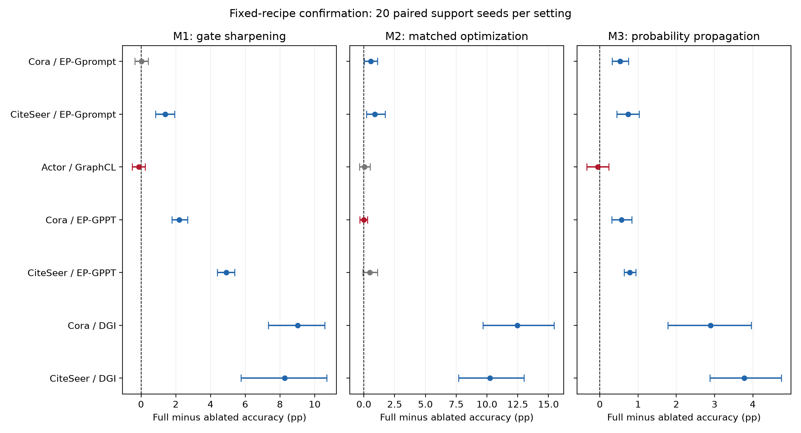

# 三模块图Prompt方案说明与实验结论

## 结论和推荐定位

已形成以主线03为基础的三模块方案：**语义门控锐化、更新尺度匹配、支持约束概率传播**。三者分别作用于同一组Prompt的生成、优化和读出，共享一个冻结GCN。它可以作为“指定预训练底座上的少样本适配”研究点组织第三或第四章；不应写成通用最优方法，也不把三个已有原子技术声称为首创。

本研究按用户更新后的要求评价条件性收益，不要求所有数据集与底座有效。明确三项贡献的范围见下表，同时保留弱效应与失败格。表中增量都是完整方案减去只移除一个模块，单位pp；区间为20个支持采样seed的配对bootstrap95%区间，未作多重比较校正。

| 数据集/底座 | M1锐化 | M2尺度匹配优化 | M3传播 | 三项区间下界均正 |
|---|---|---|---|---|
| Cora/Edgepred_Gprompt | +0.025 [-0.360, +0.405] | +0.555 [+0.015, +1.100] | +0.530 [+0.320, +0.745] | 否 |
| CiteSeer/Edgepred_Gprompt | +1.400 [+0.830, +1.935] | +0.895 [+0.210, +1.735] | +0.740 [+0.440, +1.030] | 是 |
| Actor/GraphCL | -0.135 [-0.503, +0.243] | +0.059 [-0.352, +0.507] | -0.053 [-0.342, +0.234] | 否 |
| Cora/Edgepred_GPPT | +2.205 [+1.775, +2.675] | -0.015 [-0.325, +0.290] | +0.565 [+0.310, +0.840] | 否 |
| CiteSeer/Edgepred_GPPT | +4.905 [+4.390, +5.395] | +0.475 [-0.090, +1.120] | +0.785 [+0.635, +0.945] | 否 |
| Cora/DGI | +9.025 [+7.330, +10.575] | +12.480 [+9.670, +15.455] | +2.895 [+1.775, +3.965] | 是 |
| CiteSeer/DGI | +8.270 [+5.755, +10.700] | +10.260 [+7.695, +13.010] | +3.780 [+2.875, +4.745] | 是 |

蓝色表示配对区间下界大于0；灰色为正均值但区间跨0；红色为负均值。不是经过多重校正的独立图显著性检验。

## 完整方法的收益与强基线差距

| 数据集/底座 | 000共同基础% | 111完整% | 完整−基础pp | 完整−未中心化教师pp | 完整−中心化教师pp |
|---|---:|---:|---:|---:|---:|
| Cora/Edgepred_Gprompt | 71.545 | 73.915 | +2.370 | +1.885 | +2.220 |
| CiteSeer/Edgepred_Gprompt | 63.735 | 68.305 | +4.570 | -0.510 | -2.100 |
| Actor/GraphCL | 21.566 | 21.776 | +0.211 | +1.523 | +0.595 |
| Cora/Edgepred_GPPT | 68.640 | 71.570 | +2.930 | -0.670 | -0.325 |
| CiteSeer/Edgepred_GPPT | 59.335 | 65.605 | +6.270 | -1.955 | -2.855 |
| Cora/DGI | 31.315 | 50.605 | +19.290 | -21.920 | -21.325 |
| CiteSeer/DGI | 32.535 | 47.340 | +14.805 | -20.915 | -22.055 |

000仍含条件Prompt、普通温度教师门控、Adam与共同中心化，不是没有任何适配的冻结模型。完整方案相对冻结/GraphPrompt的大增量不全部归因于三个新增开关。

CiteSeer/Edgepred_Gprompt提供清晰的三模块证据，但完整方法仍落后于中心化直接教师2.100 pp。Cora同底座的完整方法有较明确整体收益，M1却只有+0.025 pp、区间跨零；不能称其在Cora稳定有效。Actor/GraphCL未确认三模块成立。Edgepred_GPPT的优化项也未在两个数据集稳定成立。DGI的模块作用必须与它较弱的绝对性能同时解释，不能借较低起点夸大竞争力。

明确成立的同家族范围是本地ProG-adapted DGI的Cora与CiteSeer；另有CiteSeer/Edgepred_Gprompt证据。DGI完整准确率分别为50.605%和47.340%，相对未中心化直接教师仍低21.920和20.915 pp。因此，这是弱底座上的条件性适配收益，不是推荐用DGI替代强直接教师。

权重来源标记为ProG-adapted、source_parity=not_fully_verified；严格加载和哈希一致不等于已复现原论文。结论限定到报告中的实际SHA，不能代表所有DGI或GraphCL权重。

## 三个模块怎样构成一个研究点

1. **语义门控锐化**：用支持标签产生的修正原型教师及全图无标签特征构造节点条件门控，控制同一组类别token对每个节点的修正。温度0.2→0.1是本轮开关。不是训练另一个标签预测器后投票；教师仅提供门控，不使用query标签。
2. **更新尺度匹配优化**：对token梯度构造左右矩阵预条件方向，再匹配同轨迹Adam方向的范数。它是训练模块而非新增推理分支。必须与Adam比较；无匹配矩阵更新很差不等于完整矩阵本身必需，完整矩阵与对角对照的结果一并保留。
3. **支持约束概率传播**：在最终适配表示上构造50近邻，传播原型概率20步，并固定支持节点标签。它是末端读出；不能写成三种主干内Prompt相互作用。

M1改变输入到Prompt的条件，M2更新同一组参数，M3利用其输出。零初始化恢复冻结前向；主干始终冻结。当前不加入动态CE缩放和VAT，KD关闭但教师门控仍存在。输出中心化在因子实验中固定，不把共同设置充作第四个贡献。

## 试验过程与不可隐藏的选择

- 阶段1：8数据集、63份兼容checkpoint，补齐三个因子的8格；新增630读出、315次训练，锁定3860条历史参照。它是使用历史图与query的探索筛查。
- 阶段2：固定Cora/CiteSeer Edgepred_Gprompt及Actor GraphCL，20新seed24092500..19，1020结果、540次Prompt训练。
- 阶段2b：在前轮已知后，补验阶段1已记录的Cora/CiteSeer Edgepred_GPPT；固定20新seed24092600..19，680结果、360次训练。
- 阶段2c：继续固定阶段1已有候选Cora/CiteSeer DGI；20新seed24092700..19，680结果、360次训练。假设是底座对优化方向/尺度的适配需求不同，属于序贯探索扩展，不是首次盲测。

合计本目标新增3010条正式结果、1575次Prompt训练；引用不重复计入新增训练，smoke也不计入正式训练次数。每个确认轮完整保存8格、门控范数匹配/仅幅度、对角/无匹配优化、冻结/GraphPrompt及三个直接方法。各轮支持seed块不同，因此不同轮底座之间只作描述性比较，不能作同seed配对检验。

## 论文可写和不可写的主张

可写：该三阶段适配在明确数据集与指定SHA底座上有配对模块贡献；主干冻结且参数量小；实际收益具有预训练底座依赖。不同模块对应生成、优化和读出三个不同环节。

不可写：首创温度锐化/Shampoo/grafting/标签传播；三个模块普遍协同；所有图预训练模型均提升；所有数据集显著提升；整体超过全部强基线；新支持seed就是新图泛化。完整矩阵的不可替代性尚未获得普遍支持，raw锐化包含幅度变化，序贯候选选择及未校正区间必须披露。

参考两篇毕业论文的总体结构与消融组织，本研究定位为**任务适配、组件组织与条件性实证**。论文成果等级和学位审查不由这些表格自动决定。

## 文档与复现入口

- [论文章节初稿](论文章节初稿.md)：问题、公式、统一流程、实验、结果、消融和边界。
- [阶段1全因子分析](stage1_factorial/阶段1结果.md)、[全部条件性候选](stage1_factorial/条件性三模块评估.md)。
- [Edgepred_Gprompt/GraphCL确认](stage2_confirmation/确认结果.md)、[GPPT确认](stage2b_gppt_confirmation/确认结果.md)、[DGI确认](stage2c_dgi_confirmation/确认结果.md)。
- [实际成本](chapter_assets_final/成本表.md)、[梯度结构诊断](chapter_assets_final/梯度诊断.md)。条件数仅为实际轨迹的描述，不能单独证明底座类型的因果作用。
- 每阶段plan.json列出SHA、seed、100步、5-shot及源码哈希，results下保留result.json和sealed.pt；final_audit.json为服务器逐预测核验，transport_audit.json和artifact_transport_audit.json为本地核验。pair_audit.json核对共享训练，stage1另有reference_audit.json和shared_training_audit.json。

复现环境：服务器ProG Python 3.12.3、PyTorch 2.12.1+cu130、PyG 2.8.0.post1、CUDA13.0；设备报告NVIDIA GeForce RTX4080 SUPER。每次实验torch CPU线程数4，冻结模型eval，TF32关闭。按源代码和锁定计划复现，不通过改变预训练checkpoint名称代替SHA对应。
