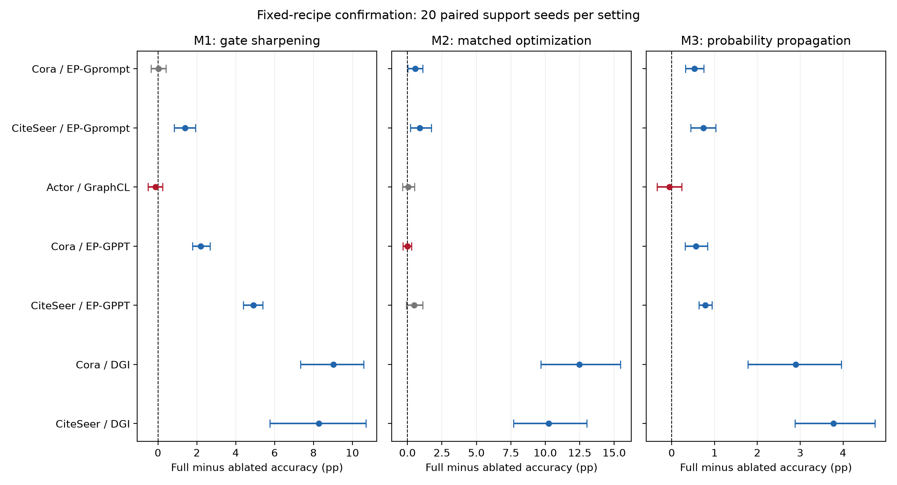

# 面向图小样本节点分类的语义条件与结构一致性Prompt适配

本章给出一个以主线03为基础、适用范围明确的三模块研究方案。实验与归档已完成，结论按数据集和底座分别陈述。模块采用已有原子机制的任务适配，不主张首创。

## 1 问题定义与设计动机

给定图 $ G=(V,E,X) $、每类5个标注支持节点集合 $ S $ 和一个预训练两层GCN，目标是在冻结主干的条件下学习少量任务参数，以预测查询节点类别。整个图的属性和结构在适配时可见；只有支持节点标签进入训练、原型构造和传播约束。查询标签仅在预测封存后用于计算准确率。这是转导小样本节点分类，不是归纳新图分类。

原主线03揭示三个可能的瓶颈：类别条件门控混合、少量Prompt参数的更新尺度与方向不协调，以及支持标签未充分约束近邻节点的最终预测。三个候选模块分别作用于Prompt生成、训练更新和最终读出。它们形成一条单主干处理流程；没有三个独立编码器，也没有末端模型投票。

## 2 共享基础与总体流程

设冻结第一层输出为 $ U $，隐藏维度 $ d=128 $，类别数为 $ C $，学习参数为 $ P\in\mathbb{R}^{C\times d} $。所有因子分支采用零初始化 $ P $，冻结GCN保持eval状态。共同的Prompt前向为

$$
H_P=\operatorname{act}\left(U+10\,[Q\tanh(P)]\odot s_U\right),\qquad Z_P=\operatorname{GCN}_2(H_P,E),
$$

其中 $ s_U $ 为各隐藏维度的节点标准差，下限为 $ 10^{-6} $；$ Q $ 是由支持标签与无标签属性共同产生的门控。幅度10来自锁定的历史配方，本轮不根据query调节。零初始化时Prompt修正为零，恢复冻结主干的原始表示。

训练使用支持节点留一原型交叉熵与token均方正则：

$$
\mathcal{L}=\mathcal{L}_{\mathrm{CE,LOO}}(Z_P,S)+0.001\operatorname{mean}(P\odot P).
$$

类别原型基于归一化表示的支持节点均值再归一化，余弦logit温度为0.2。当前分支不加入KD损失，尽管源码仍计算并记录KD诊断值。**记录KD数值不代表KD参与反向目标。** 查询节点标签不参与留一损失。

训练后采用固定输出中心化 $ Z=Z_P-\operatorname{mean}_V(Z_P) $。中心化是各分支共同设置，本阶段不把它计为第四个有效模块。若后续改变中心化，必须作为另一个有匹配对照的实验。

## 3 模块一：语义条件门控锐化

先对规范化节点属性作两跳传播并中心化，使用支持类原型和未标注节点的软分配构造修正教师分数 $ B $。当前教师固定三次迭代、支持原型与软原型各占0.5；软分配温度0.05，输出分数温度0.2。

门控概率与传播门控为

$$
\Pi_T=\operatorname{softmax}(B\cdot0.2/T),\qquad Q_T=\widehat A\left(\Pi_T-\operatorname{mean}_V(\Pi_T)\right).
$$

普通分支 $ T=0.2 $，锐化分支 $ T=0.1 $。$ \widehat A $ 为带自环的GCN归一化邻接算子。门控本身不训练，训练参数只有 $ P $。教师利用未标注节点特征，但不使用它们的真实标签。

设计目的：让节点对各类别token的组合更有区分性。严格边界：raw温度锐化既改变分配形状，也可能改变门控范数，当前消融衡量整个操作，不足以单独证明“语义更准确”。本章确认阶段已包含等范数匹配及仅幅度对照。

## 4 模块二：方向与更新尺度分离的Prompt优化

对当前token梯度 $ G_t $ 累加两个矩阵统计：

$$
L_t=10^{-4}I+\sum_{i=1}^t G_iG_i^\top,\qquad R_t=10^{-4}I+\sum_{i=1}^t G_i^\top G_i.
$$

矩阵预条件方向为

$$
D_t=L_t^{-1/4}G_tR_t^{-1/4}.
$$

同时在**同一实际梯度序列**上计算Adam方向 $ A_t $，动量系数0.9/0.999，偏差校正后分母加 $ 10^{-8} $。最终更新为

$$
P_{t+1}=P_t-0.01\,D_t\frac{\lVert A_t\rVert_F}{\lVert D_t\rVert_F}.
$$

若 $ \lVert D_t\rVert_F=0 $，明确使用零更新。矩阵统计与特征分解在CPU float64执行，更新转回GPU参数dtype。每步保留原始梯度、方向范数、Adam范数和匹配后的名义更新范数。范数诊断按float64记录，实际float32参数应用还包含舍入误差。

这个“Adam尺度”来自当前矩阵更新轨迹上的梯度，并不等于独立Adam训练轨迹的逐步更新。不能把它写成与独立Adam每一步严格相同的学习动态。M2开关比较匹配Shampoo与合理Adam基线；额外使用对角预条件和无匹配Shampoo区分矩阵方向与尺度作用。Shampoo和grafting均为已有算法，贡献边界是其在本图Prompt系统中的任务适配与条件性证据。

## 5 模块三：支持约束的近邻概率传播

由中心化后的归一化嵌入构建每节点50个非自身近邻。近邻相似度除以0.2后softmax得到行归一化权重矩阵 $ W $。初始类别概率 $ F_0 $ 由支持原型产生，迭代

$$
F_{t+1}=0.1F_0+0.9WF_t,\qquad (F_{t+1})_S=Y_S,
$$

固定20轮。支持节点在初始化和每次迭代均钳制为真实支持one-hot标签。最终使用 $ \log(\max(F_{20},10^{-12})) $ 作为分数。模块关闭时直接用支持原型logit分类。

它不修改token、主干或训练损失；它是基于本次适配表示的末端概率读出。高相似度未必代表同类别，所以不能假定传播必然有效，异配数据集负迁移应作为边界报告。

## 6 参数量、计算代价与实验要求

仅一组 $ C\times128 $ token进入优化器；源码中的备用tokens2在本分支不加入参数列表。M1不额外引入可学习权重，M2增加每步 $ C\times C $ 与 $ 128\times128 $ 矩阵分解和CPU/GPU传输，M3需要精确近邻构建与20次概率传播。当前近邻以1024节点分块计算全节点相似度，计算量仍为二次规模，不能声称线性复杂度。

因此，相同100步并不代表相同时间预算。实验应分别报告训练、近邻构建及推理耗时，注明缓存读取和首次运行的差别，不将两个读出共享训练后的单行seconds直接相加解释为独立训练成本。


## 7 统一训练与推理算法

```text
输入：图属性/结构，支持节点及其标签，冻结两层GCN，固定seed
构造两跳属性、修正原型教师和温度门控Q
初始化类别token P=0；冻结主干并保持eval
重复100步：
    在第一层预激活加入10*(Q@tanh(P))*std(U)
    前向得到Z；计算支持留一原型CE与token正则
    只对P反向求梯度
    按开关使用Adam或方向/尺度匹配更新
对最终Z作共同中心化
按开关直接原型分类，或构建50近邻并进行20步支持钳制概率传播
封存支持索引、query索引、分数、预测、token与诊断
预测封存后，才使用query标签计算准确率
```

## 8 实验协议与可复现性

使用Cora、CiteSeer的官方训练节点池/测试节点，每类抽取5个支持标签；Actor使用官方fold0。原8数据集筛查还包括PubMed、Computers、Photo、Chameleon、Cornell，不能把它们都声称为成功场景。Planetoid输入使用NormalizeFeatures；Actor主干输入保留原特征，教师使用规范化特征。查询集合固定，输入特征与结构可转导访问，查询标签不进入拟合。详细节点数、类别数、query规模、池划分及权重路径以各stage的plan.json为准。

主对比采用同seed、同checkpoint配对，另保留不依赖checkpoint的直接教师。教师每数据集每seed只计算一次，不因为在多个checkpoint比较就增加独立样本数。因子开关Fabc的a/b/c依次代表锐化、匹配优化、传播。每个模型的可训练token数为类别数×128；GraphPrompt基线为本地适配实现，不能把其数字直接宣称为原论文最佳复现。Edgepred_Gprompt是预训练family名称，GraphPrompt是下游适配基线，两者不能混淆。

20个新支持seed的配对区间使用固定随机数20260924和10000次有放回重采样；描述同一图、固定query集合下的支持采样波动。候选经过历史探索且未作多重比较校正，因此不用这些区间宣称无选择偏差的独立图显著性。

## 9 完整方法、组件消融与适用边界

## 结论和推荐定位

已形成以主线03为基础的三模块方案：**语义门控锐化、更新尺度匹配、支持约束概率传播**。三者分别作用于同一组Prompt的生成、优化和读出，共享一个冻结GCN。它可以作为“指定预训练底座上的少样本适配”研究点组织第三或第四章；不应写成通用最优方法，也不把三个已有原子技术声称为首创。

本研究按用户更新后的要求评价条件性收益，不要求所有数据集与底座有效。明确三项贡献的范围见下表，同时保留弱效应与失败格。表中增量都是完整方案减去只移除一个模块，单位pp；区间为20个支持采样seed的配对bootstrap95%区间，未作多重比较校正。

| 数据集/底座 | M1锐化 | M2尺度匹配优化 | M3传播 | 三项区间下界均正 |
|---|---|---|---|---|
| Cora/Edgepred_Gprompt | +0.025 [-0.360, +0.405] | +0.555 [+0.015, +1.100] | +0.530 [+0.320, +0.745] | 否 |
| CiteSeer/Edgepred_Gprompt | +1.400 [+0.830, +1.935] | +0.895 [+0.210, +1.735] | +0.740 [+0.440, +1.030] | 是 |
| Actor/GraphCL | -0.135 [-0.503, +0.243] | +0.059 [-0.352, +0.507] | -0.053 [-0.342, +0.234] | 否 |
| Cora/Edgepred_GPPT | +2.205 [+1.775, +2.675] | -0.015 [-0.325, +0.290] | +0.565 [+0.310, +0.840] | 否 |
| CiteSeer/Edgepred_GPPT | +4.905 [+4.390, +5.395] | +0.475 [-0.090, +1.120] | +0.785 [+0.635, +0.945] | 否 |
| Cora/DGI | +9.025 [+7.330, +10.575] | +12.480 [+9.670, +15.455] | +2.895 [+1.775, +3.965] | 是 |
| CiteSeer/DGI | +8.270 [+5.755, +10.700] | +10.260 [+7.695, +13.010] | +3.780 [+2.875, +4.745] | 是 |



蓝色表示配对区间下界大于0；灰色为正均值但区间跨0；红色为负均值。不是经过多重校正的独立图显著性检验。

## 完整方法的收益与强基线差距

| 数据集/底座 | 000共同基础% | 111完整% | 完整−基础pp | 完整−未中心化教师pp | 完整−中心化教师pp |
|---|---:|---:|---:|---:|---:|
| Cora/Edgepred_Gprompt | 71.545 | 73.915 | +2.370 | +1.885 | +2.220 |
| CiteSeer/Edgepred_Gprompt | 63.735 | 68.305 | +4.570 | -0.510 | -2.100 |
| Actor/GraphCL | 21.566 | 21.776 | +0.211 | +1.523 | +0.595 |
| Cora/Edgepred_GPPT | 68.640 | 71.570 | +2.930 | -0.670 | -0.325 |
| CiteSeer/Edgepred_GPPT | 59.335 | 65.605 | +6.270 | -1.955 | -2.855 |
| Cora/DGI | 31.315 | 50.605 | +19.290 | -21.920 | -21.325 |
| CiteSeer/DGI | 32.535 | 47.340 | +14.805 | -20.915 | -22.055 |

000仍含条件Prompt、普通温度教师门控、Adam与共同中心化，不是没有任何适配的冻结模型。完整方案相对冻结/GraphPrompt的大增量不全部归因于三个新增开关。

CiteSeer/Edgepred_Gprompt提供清晰的三模块证据，但完整方法仍落后于中心化直接教师2.100 pp。Cora同底座的完整方法有较明确整体收益，M1却只有+0.025 pp、区间跨零；不能称其在Cora稳定有效。Actor/GraphCL未确认三模块成立。Edgepred_GPPT的优化项也未在两个数据集稳定成立。DGI的模块作用必须与它较弱的绝对性能同时解释，不能借较低起点夸大竞争力。


### 9.1 八格因子消融

Fabc的三个二进制位依次是M1、M2、M3。表内为准确率均值±支持seed标准差，不能据跨轮不同seed块对底座作配对排名。

#### Edgepred_Gprompt

| 因子组合 | Cora | CiteSeer |
|---|---:|---:|
| F000 | 71.545 ± 2.650 | 63.735 ± 2.337 |
| F001 | 72.645 ± 2.618 | 65.025 ± 2.506 |
| F010 | 72.525 ± 2.024 | 65.770 ± 2.616 |
| F011 | 73.890 ± 2.151 | 66.905 ± 2.373 |
| F100 | 72.585 ± 2.177 | 66.775 ± 2.584 |
| F101 | 73.360 ± 2.380 | 67.410 ± 2.726 |
| F110 | 73.385 ± 2.360 | 67.565 ± 2.356 |
| F111 | 73.915 ± 2.351 | 68.305 ± 2.104 |

#### Edgepred_GPPT

| 因子组合 | Cora | CiteSeer |
|---|---:|---:|
| F000 | 68.640 ± 2.518 | 59.335 ± 2.063 |
| F001 | 69.380 ± 2.337 | 60.055 ± 2.140 |
| F010 | 68.665 ± 2.496 | 59.970 ± 1.763 |
| F011 | 69.365 ± 2.417 | 60.700 ± 1.950 |
| F100 | 71.050 ± 2.863 | 64.545 ± 1.974 |
| F101 | 71.585 ± 2.736 | 65.130 ± 2.115 |
| F110 | 71.005 ± 2.488 | 64.820 ± 2.038 |
| F111 | 71.570 ± 2.776 | 65.605 ± 2.089 |

#### DGI

| 因子组合 | Cora | CiteSeer |
|---|---:|---:|
| F000 | 31.315 ± 4.977 | 32.535 ± 2.738 |
| F001 | 32.780 ± 4.029 | 33.325 ± 3.234 |
| F010 | 40.520 ± 4.981 | 36.155 ± 3.596 |
| F011 | 41.580 ± 3.781 | 39.070 ± 3.645 |
| F100 | 34.875 ± 5.638 | 35.050 ± 4.027 |
| F101 | 38.125 ± 6.033 | 37.080 ± 4.637 |
| F110 | 47.710 ± 4.481 | 43.560 ± 4.710 |
| F111 | 50.605 ± 3.603 | 47.340 ± 5.294 |

#### GraphCL

| 因子组合 | Actor |
|---|---:|
| F000 | 21.566 ± 1.534 |
| F001 | 21.625 ± 1.729 |
| F010 | 21.836 ± 1.489 |
| F011 | 21.911 ± 1.538 |
| F100 | 21.474 ± 1.677 |
| F101 | 21.717 ± 1.654 |
| F110 | 21.829 ± 1.464 |
| F111 | 21.776 ± 1.600 |

### 9.2 机制对照

以下为完整方法减对应机制替代，单位pp。完整区间、逐seed差和全部二/三阶交互可在各确认报告复核，不能只看本表正值。

| 数据集/底座 | 对等范数门控 | 对仅幅度门控 | 对对角更新 | 对无匹配矩阵更新 |
|---|---:|---:|---:|---:|
| Cora/Edgepred_Gprompt | +0.165 | -0.355 | +0.365 | +22.165 |
| CiteSeer/Edgepred_Gprompt | +0.500 | +0.545 | +0.310 | +25.940 |
| Actor/GraphCL | -0.112 | -0.138 | +0.099 | +0.237 |
| Cora/Edgepred_GPPT | +0.805 | +0.980 | -0.455 | +30.340 |
| CiteSeer/Edgepred_GPPT | +2.030 | +2.315 | +0.220 | +33.620 |
| Cora/DGI | +6.485 | +1.995 | +3.475 | +26.375 |
| CiteSeer/DGI | +5.350 | +2.345 | +3.710 | +20.605 |

DGI两个数据集的完整矩阵优于对角对照，Cora/GPPT则对角更优；不能把矩阵复杂性描述为始终必要。Cora/Edgepred_Gprompt的仅幅度门控均值更高，说明锐化语义解释依赖具体场景。二阶及三阶交互有负值，完整系统三个移除差为正不等于超加性协同。

- [stage2_confirmation：完整对比、配对区间和全部交互](stage2_confirmation/确认结果.md)

- [stage2b_gppt_confirmation：完整对比、配对区间和全部交互](stage2b_gppt_confirmation/确认结果.md)

- [stage2c_dgi_confirmation：完整对比、配对区间和全部交互](stage2c_dgi_confirmation/确认结果.md)

## 10 计算成本与梯度诊断

# 实验成本

单位秒，20个seed均值；不含数据/权重加载与预测封存序列化；读出包含近邻文件写盘，训练计时包含教师/门控构建。F101为锐化Adam+传播，F110为锐化匹配Shampoo无传播，F111为完整方法。共享训练不能重复计数，统计来源是运行时计时，不是严格隔离GPU性能基准。

| 数据集/底座 | 方法 | 可训练参数 | 训练秒 | 读出秒 | 合计秒 |
|---|---|---:|---:|---:|---:|
| Cora/Edgepred_Gprompt | F101 | 896 | 0.322 | 0.012 | 0.334 |
| Cora/Edgepred_Gprompt | F110 | 896 | 0.465 | 0.000 | 0.465 |
| Cora/Edgepred_Gprompt | F111 | 896 | 0.465 | 0.012 | 0.477 |
| Cora/Edgepred_Gprompt | M2_diagonal | 896 | 0.350 | 0.012 | 0.361 |
| Cora/Edgepred_Gprompt | M2_ungrafted | 896 | 0.449 | 0.012 | 0.460 |
| CiteSeer/Edgepred_Gprompt | F101 | 768 | 0.340 | 0.014 | 0.354 |
| CiteSeer/Edgepred_Gprompt | F110 | 768 | 0.506 | 0.000 | 0.506 |
| CiteSeer/Edgepred_Gprompt | F111 | 768 | 0.506 | 0.014 | 0.520 |
| CiteSeer/Edgepred_Gprompt | M2_diagonal | 768 | 0.372 | 0.015 | 0.387 |
| CiteSeer/Edgepred_Gprompt | M2_ungrafted | 768 | 0.496 | 0.015 | 0.510 |
| Actor/GraphCL | F101 | 640 | 0.358 | 0.027 | 0.385 |
| Actor/GraphCL | F110 | 640 | 0.533 | 0.000 | 0.533 |
| Actor/GraphCL | F111 | 640 | 0.533 | 0.027 | 0.560 |
| Actor/GraphCL | M2_diagonal | 640 | 0.384 | 0.027 | 0.411 |
| Actor/GraphCL | M2_ungrafted | 640 | 0.507 | 0.027 | 0.534 |
| Cora/Edgepred_GPPT | F101 | 896 | 0.313 | 0.012 | 0.325 |
| Cora/Edgepred_GPPT | F110 | 896 | 0.479 | 0.000 | 0.480 |
| Cora/Edgepred_GPPT | F111 | 896 | 0.479 | 0.012 | 0.491 |
| Cora/Edgepred_GPPT | M2_diagonal | 896 | 0.341 | 0.012 | 0.353 |
| Cora/Edgepred_GPPT | M2_ungrafted | 896 | 0.475 | 0.012 | 0.487 |
| CiteSeer/Edgepred_GPPT | F101 | 768 | 0.322 | 0.013 | 0.335 |
| CiteSeer/Edgepred_GPPT | F110 | 768 | 0.480 | 0.000 | 0.481 |
| CiteSeer/Edgepred_GPPT | F111 | 768 | 0.480 | 0.014 | 0.494 |
| CiteSeer/Edgepred_GPPT | M2_diagonal | 768 | 0.349 | 0.014 | 0.363 |
| CiteSeer/Edgepred_GPPT | M2_ungrafted | 768 | 0.463 | 0.014 | 0.477 |
| Cora/DGI | F101 | 896 | 0.324 | 0.012 | 0.336 |
| Cora/DGI | F110 | 896 | 0.528 | 0.000 | 0.529 |
| Cora/DGI | F111 | 896 | 0.528 | 0.012 | 0.540 |
| Cora/DGI | M2_diagonal | 896 | 0.354 | 0.012 | 0.366 |
| Cora/DGI | M2_ungrafted | 896 | 0.515 | 0.012 | 0.526 |
| CiteSeer/DGI | F101 | 768 | 0.341 | 0.014 | 0.354 |
| CiteSeer/DGI | F110 | 768 | 0.542 | 0.000 | 0.542 |
| CiteSeer/DGI | F111 | 768 | 0.542 | 0.014 | 0.556 |
| CiteSeer/DGI | M2_diagonal | 768 | 0.369 | 0.014 | 0.383 |
| CiteSeer/DGI | M2_ungrafted | 768 | 0.506 | 0.014 | 0.520 |

# 支持梯度结构诊断

在完整F111实际训练轨迹上重建累积左右梯度二阶矩（包含1e-4稳定项），计算log10条件数、右矩阵有效秩和每步步长匹配倍率的中位数。以下先按seed统计再取均值。这是描述性诊断；不同底座的训练预算、表示质量和梯度轨迹均有差异，不能据此单独归因为预训练目标。

| 数据集/底座 | log10左条件数 | log10右条件数 | 右有效秩 | 匹配倍率中位数的均值 |
|---|---:|---:|---:|---:|
| Cora/Edgepred_Gprompt | 2.861 | 4.226 | 6.098 | 83.807 |
| CiteSeer/Edgepred_Gprompt | 2.399 | 4.171 | 4.845 | 75.264 |
| Actor/GraphCL | 3.424 | 4.640 | 8.322 | 44.155 |
| Cora/Edgepred_GPPT | 3.564 | 4.336 | 4.719 | 60.818 |
| CiteSeer/Edgepred_GPPT | 3.319 | 4.484 | 3.343 | 57.109 |
| Cora/DGI | 3.134 | 3.708 | 3.336 | 68.375 |
| CiteSeer/DGI | 3.233 | 3.807 | 2.805 | 71.094 |

## 11 与参考论文的组织对应及贡献边界

聂雄论文第三章按总体框架、三个模块、算法步骤、主对比、跨数据集与模块消融展开，PDF45页表3-5包含完整8种模块组合。本章借鉴该消融组织，但不照搬其对协同作用的解释。向苡霄论文第三章图3-1（PDF28页）强调模块在统一流程中的作用，PDF40页表3-4/3-5将改进与DAFormer基础比较；本章同样区分共享基础与新增开关，而不把冻结主干到最终系统的所有差值归因于三模块。两篇论文的指标是作者报告，未在本项目复现。

技术来源包括GraphPrompt、MixMatch中的温度锐化、Shampoo、方向/学习率分离，以及基于标签传播的Correct and Smooth。具体引用见研究设计与章节框架.md。这里的贡献应限定为图小样本Prompt场景的组件组织、接口设计和条件性实验；已有算法名称不能改名后宣称首创。

## 12 本章小结

本章围绕单一冻结GCN上的条件Prompt，分别从语义门控、更新方向与尺度、预测结构约束三个环节构建方法。三模块贡献在指定底座与数据集上成立，适用范围由完整因子筛查和固定支持采样确认界定；Cora部分设置的微弱/负贡献、Actor失败以及强直接教师优势同样属于结论。整体任务收益、单模块贡献、复杂性必要性与机制原创性是不同证据层级。本章不将有正均值的个别配置扩展为普适有效方法。

参考资料与完整实验入口：见三模块方案说明与实验结论.md，以及研究设计与章节框架.md。

梯度诊断补充：DGI的右侧累积矩阵条件数并不高于所有边预测底座，因此数据不支持“DGI条件数更高就导致优化增益更大”的简单解释。较低有效秩及训练轨迹差异是描述现象，不是已证明的因果机制。

完整性边界补充：同家族两个数据集的三模块明确证据来自指定ProG-adapted DGI checkpoint；该完整方案绝对性能仍明显落后强直接教师。权重source_parity=not_fully_verified，不能将本地适配结论泛化为原论文家族的普遍表现。
