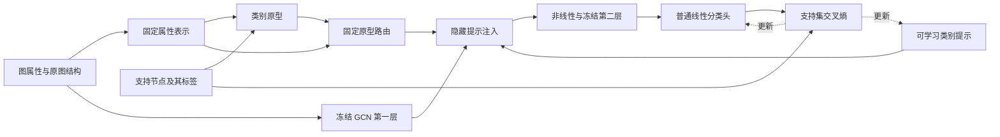

# PRPrompt：面向少样本节点分类的原型路由图提示

**PRPrompt: Prototype-Routed Graph Prompting for Few-Shot Node Classification**

版本：v2，2026-09-30。本文是裁剪后方案的叙事与方法稿；新版本正式实验尚未完成，不包含从旧方案转移的性能结论。

## 一句话贡献

PRPrompt 用支持集类别原型确定节点的提示组合权重，在冻结 GCN 的内部注入可学习类别提示，让少量标注主要用于学习提示内容与分类器，而不再同时估计一个独立的路由网络。

“原型路由”指连续加权组合，不是硬分配或新的可学习专家网络；中心化后权重可能为负，不能将其称为类别概率。

## 摘要草稿

少样本节点分类要求模型在极少监督下把预训练表示转化为当前任务可用的判别信息。图提示为这一适配提供了参数受限的途径，但节点相关提示仍需确定不同节点应该接收哪些提示；从少量标签同时学习提示内容和路由关系，会增加待估计的自由度。本文提出 PRPrompt，一种由支持集原型关系组织的图提示方案。该方法先在固定属性表示中构造类别原型，获得节点与任务类别的软关联，再据此组合少量可学习类别提示，并将提示注入冻结 GCN 的隐藏计算过程。提示参数与普通线性分类头使用支持集交叉熵联合训练。我们设计了覆盖冻结表示、完整微调及已有提示算子的匹配实验，重点检验相同预训练模型和标签预算下，原型路由提示相对冻结读出、完整微调和已有提示算子的适配收益。**最后的结果句须由该版本的正式实验填写；当前不能写“显著优于”或给出旧方案提升数值。**

## 引言草稿

图节点分类常面临一个实际限制：目标图的连接和属性已经可用，但每个类别只有少量标注。预训练图编码器可以从无标签图中学习表示，然而直接使用冻结表示不一定满足当前类别划分；完整微调又需要用有限监督调整大量参数。图提示因此成为一个值得研究的适配方式：保持编码器参数不变，通过少量可学习提示改变模型处理目标图的方式。

已有工作从不同位置实现这一思想。GraphPrompt 通过提示调整表示读出；GPF 用共享特征提示变换输入，GPF-plus 进一步使用可学习注意力组合提示基。它们说明，提示不仅是一个附加向量，还涉及“提示如何分配给节点”的问题。对一张包含多个类别的图，完全共享的提示难以直接表达任务内的类别差异；而学习节点相关路由则需要额外参数和监督。这里的问题不是现有方法没有类别信息，而是类别信息通过何种路径影响提示的分配。

我们关注一个更具体的选择：**能否利用支持集已经提供的类别关系，先固定节点到类别提示的路由，再把可学习部分集中到提示向量本身？** 少量支持节点在属性空间中定义了一组任务相关参照。一个未标注节点与这些参照的关系可以作为提示组合条件，而不必先把它作为可靠伪标签，也不必对它作最终分类。这样的条件只是对提示分配的归纳偏置，其质量依赖属性和图结构；它不是已被证明正确的类别归属。

基于这一思路，我们提出 PRPrompt。首先，对图属性作固定的局部聚合，并从支持集构造类别原型。其次，以节点与原型的相似度形成软关联，经中心化和原图聚合后得到固定的提示组合系数。最后，将这些系数组合的可学习类别向量注入冻结 GCN 第一层的预激活表示，再由后续非线性与冻结图卷积生成用于分类的表示。最终分类仍采用普通线性头，避免把路由原型和分类读出混为同一对象。

这一设计的核心不是增加一个额外分类器，而是用任务原型关系控制冻结编码器内部的提示输入。在参数上，提示只包含一个类别数乘隐藏维数的矩阵；在信息上，类别标签只来自支持集，路由构造和编码器仍可访问整图无标签属性与边。因此本文处理的是**同图、已知类别、传导式少样本节点分类**，不声称属于未见类别的元学习或跨图归纳任务。

固定路由是否优于可学习路由、隐藏注入是否优于仅训练分类头、预训练是否比随机冻结表示更有帮助，都不能仅靠形式设计回答。本文将完整 PRPrompt 与预训练冻结读出、完整微调及已有提示算子放在同一标签预算下比较，以相同 checkpoint 和支持抽样进行匹配比较。收益只在部分预训练来源成立时，应报告条件性适配效果。

## 拟表达的贡献及证据状态

| 拟表达内容 | 当前能成立的范围 | 正式写成结果前需要什么 |
|---|---|---|
| 提出支持原型固定路由的隐藏提示参数化 | 有明确公式、独立实现与标签接口 | 与 GPF-plus、共享隐藏提示、学习路由对照；不能据此直接宣称全新原语 |
| 少量提示参数即可改变冻结 GCN 的内部计算 | 可验证参数数量、梯度及零提示等价 | 这些是实现事实，不是精度或泛化证据 |
| 在少样本条件下提供有效适配 | 尚待验证 | 对 FrozenLinear、FrozenPrototype、FullFineTune 及已有 Prompt 的匹配结果 |

## 方法

### 任务与冻结编码器

给定图 $ G=(X,A) $、支持节点集合 $ S $ 及其标签 $ y_S $，任务包含 $ C $ 个已知类别。记带自环的对称归一化邻接为 $ \hat A $。当前实现使用两层预训练 GCN，第一层预激活为 $ U $，后续使用 LeakyReLU 与第二层卷积。适配期间编码器权重固定。

查询标签不参与构造提示、选参、停止训练或选择 checkpoint。整图属性、边和无标签节点统计参与构造，这一信息条件须与对照共同披露。

### 支持原型确定路由

先计算固定属性表示，并进行全图中心化及逐行归一化：

$$
R=\operatorname{RowNorm}\left(\hat A^2X-\mathbf 1\,\operatorname{MeanRows}(\hat A^2X)\right).
$$

类别参照只由对应支持节点构造：

$$
c_k=\operatorname{Normalize}\left(\frac{1}{|S_k|}\sum_{i\in S_k}R_i\right),\qquad
Q_{ik}=\frac{\exp(R_i^\top c_k/\tau)}{\sum_{j=1}^{C}\exp(R_i^\top c_j/\tau)}.
$$

固定提示系数为：

$$
B=\hat A\left(Q-\mathbf 1\,\operatorname{MeanRows}(Q)\right).
$$

这里的 $ Q $ 是路由软关联，$ B $ 是带符号的组合系数。没有将未标注节点的预测反复并入原型，也没有对查询预测进行后处理传播。$ \hat A $ 在此用于组织提示，属于前向提示构造中的结构条件。

### 提示进入冻结网络

令可学习提示矩阵为 $ P\in\mathbb R^{C\times d_h} $，$ s $ 为 $ U $ 各通道的全图标准差（实现使用总体标准差并下限截断）。提示后的隐藏输入与输出为：

$$
\widetilde U=U+\alpha\left(B\tanh(P)\right)\odot s,\qquad
Z=f_{\theta,2}\left(\operatorname{LeakyReLU}(\widetilde U),A\right).
$$

以 $ P=0 $ 初始化，模型起点等于原冻结编码器。这保证从原模型出发，不保证训练后不会退化。注入位于非线性和后续图卷积之前，因此不是在最终表示之后直接乘一个分类矩阵；但这种位置差别也不自动保证优于线性探针。

### 普通分类和训练

所有使用线性头的适配方法共享逐行归一化及线性分类形式：

$$
\ell_i=W\operatorname{Normalize}(Z_i)+b,\qquad
\mathcal L=-\frac{1}{|S|}\sum_{i\in S}\log\operatorname{softmax}(\ell_i)_{y_i}.
$$

使用普通 Adam 更新 $ P,W,b $，权重衰减按支持内选参协议确定。原型不是最终分类头。提示参数为 $ Cd_h $，分类头参数为 $ Cd_z+C $，不把分类头漏出参数效率统计。其余无标签计算和路由存储同样计入时间/内存，不能用参数少替代速度优势证明。

## 论文图表如何组织

主图只包含“支持样本定义类别参照 → 原型关系组合提示 → 提示进入冻结编码器 → 普通分类头”这一条计算链。图中用锁标识冻结编码器，用训练箭头标识提示矩阵和分类头；不把优化器或预测后处理画成研究贡献。

主表按“预训练冻结读出 / 预训练微调 / 预训练提示”分组，完整 PRPrompt 只占一个方法行。列为数据集、预训练来源和 shot 条件，统一报告均值与支持抽样间标准差。接着报告 shot 曲线、参数和实际适配耗时，以及有明确问题的路由/预训练对照。

## 限制与暂不宣称的内容

固定原型可能对支持抽样敏感；属性相似度可能与目标类别无关；两跳平滑可能伤害异配图；全图统计使其不是严格归纳方法；当前代码针对两层 GCN 而非任意模型。既有 checkpoint 的预训练来源限制会继承到结论中。即便获得均值提升，也不能把同图多次支持抽样当成多个独立数据集，更不能忽略冻结读出或完整微调的反例。
