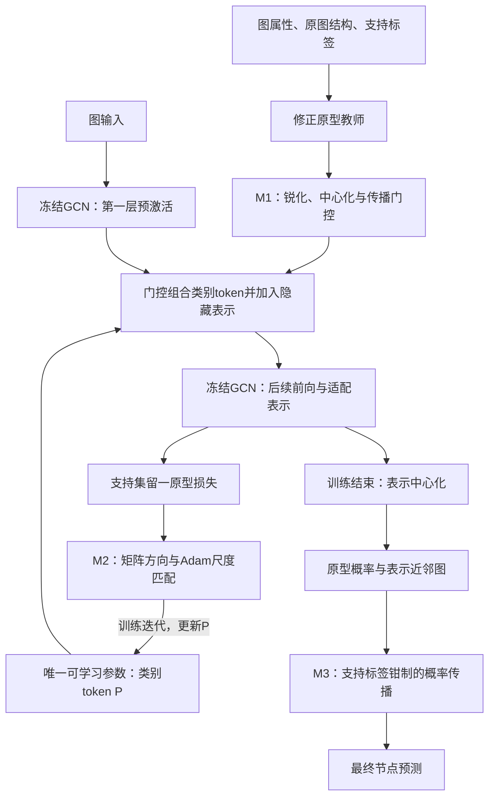

# 面向少样本节点分类的语义条件、尺度匹配与结构一致性图提示适配

> 写作日期：2026-09-24。本文基于“主线03”和“三底座统一协议对比”的现有材料构建研究叙事，不新增实验。主结果采用最新统一协议的1680条记录；早期确认实验单独注明，不混入本轮数值。文中的“瓶颈”是本文研究的问题与机制假设，不表示整个领域已经公认所有方法都存在同样缺陷。

## 一、核心叙事：少量标签如何贯穿图提示适配的全过程

**本研究关注的问题是：在冻结图预训练主干、每类仅有少量标注的条件下，如何把有限的类别监督转化为节点相关的提示修正，并通过合适的参数更新和预测约束，使其形成有效的分类结果。**

图提示学习通过学习少量参数，将预训练模型适配到下游任务。但一个提示结构能够插入冻结主干，并不意味着有限标签已经被充分利用。对于本文采用的类别条件提示框架，仍需要回答三个相互衔接的问题：不同节点应如何组合类别提示；这些提示应如何在有限更新预算下学习；学习得到的表示应如何结合支持标签和节点关系形成最终预测。

围绕这三个问题，本文构建语义门控锐化、更新尺度匹配和支持约束概率传播三个模块。第一个模块调整节点对类别提示的条件分配，第二个模块调整同一组提示参数的更新方向与尺度，第三个模块在适配后的表示空间中传播类别概率。三者共同构成“语义分配—参数更新—预测约束”的适配流程。

这条主线的研究价值在于：把少样本图提示的效果分解到可检验的不同环节，明确每项设计在什么底座与数据条件下有用，而不是仅以增加提示参数或更换插入位置解释性能变化。现有结果支持完整流程相对共同基础的收益，也显示不同模块对预训练底座有明显依赖。

## 二、参考论文如何组织叙事，以及本研究怎样借鉴

### 2.1 两篇硕士论文：从任务特性推导模块分工

聂雄论文第三章先分析真实失真图像的三个特性：多层信息共同影响质量、失真具有局部非均匀性、失真类型存在差异；再分别引出特征融合、区域失真提取和差异化专家处理。其叙事并非先列出三个技术名称，而是先说明现有处理方式在哪个具体环节不充分，再给出对应设计。总体框架进一步解释各模块的输入输出关系。本文借鉴这一“任务特性—具体不足—模块设计”的组织方式。[原文PDF第30–33页；本地提取文本](/Users/shq/Research/GP/持续推进/主线03_硕士论文三模块_20260924/references/nie.txt)

向苡霄论文第三章围绕域偏移这一总问题，将输入层的数据处理与表示层的对比约束放入同一训练过程，并以DAFormer为基础报告新增设计的增量。本文借鉴其“一个总问题、多个作用层次、同一处理流程”的叙事，以及明确区分基础系统和新增模块的做法。[原文PDF第26–30、40页；本地提取文本](/Users/shq/Research/GP/持续推进/主线03_硕士论文三模块_20260924/references/xiang.txt)

借鉴结构不意味着照搬结论。聂雄论文表3-5中，单独区域失真模块与完整模型的SRCC分别为0.9032和0.9033，说明“完整系统最高”本身不足以证明每个模块都有很强贡献；向苡霄论文的逐项加入实验也不能替代所有组合下的交互检验。因此，本文分别呈现完整方案收益、逐项移除差值和机制解释，不将三者混为一谈。上述论文数值仅用于说明写作与消融组织，属于作者报告。

### 2.2 图提示论文：承认已有进展，再限定具体研究缺口

| 参考工作 | 论文组织问题的方式 | 本研究可借鉴之处 |
|---|---|---|
| GraphPrompt | 从预训练与下游任务的差异出发，引出统一任务模板和任务相关提示 | 先说明适配目标，再解释提示如何调用预训练表示 |
| EdgePrompt | 将讨论聚焦到边在提示设计和消息传递中的作用 | 将不足落到具体信息通道，而不笼统宣称已有方法无效 |
| GraphTOP | 从特征层提示的关注点引出拓扑层的适配空间 | 明确新增操作真正改变什么对象，以及与已有方法的区别 |
| UniPrompt | 讨论提示作用机制和不同下游场景的适应性，强调区分模型能力与分类器作用 | 将主干内适配与最终分类读出分开解释，并检验底座依赖 |

来源：[GraphPrompt论文摘要](https://arxiv.org/abs/2302.08043)、[EdgePrompt作者摘要与代码](https://github.com/xbfu/EdgePrompt)、[GraphTOP作者摘要与代码](https://github.com/xbfu/GraphTOP)、[UniPrompt论文摘要](https://arxiv.org/abs/2509.22416)。EdgePrompt和GraphTOP的叙事依据也保存在本项目上游仓库README中。

这些工作已经涉及结构、任务条件或适配机制。因此，本研究不宜写成“现有图Prompt完全忽略结构”或“首次利用类别信息”。更准确的切入点是：**在本文限定的冻结主干、类别条件提示和极少标注场景中，提示的条件分配、更新方式与最终结构读出仍值得联合设计和分别检验。** 这是本文选择的研究问题，不是已经完成穷尽检索的领域空白证明。

## 三、当前场景有什么不足，为什么对应这三个模块

本文研究转导少样本节点分类：适配时可访问整张图的属性与边，只有支持节点标签进入拟合；查询标签仅用于封存预测后的评价。主干为冻结的两层GCN。这里的“语义”特指支持类别语义，不涉及文本提示或语言模型。

| 具体问题 | 可能造成的限制 | 本文设计 | 作用对象 |
|---|---|---|---|
| 条件提示的类别分配可能过于分散 | 不同节点获得相似的类别token组合，限制提示的差异化作用 | M1：语义门控锐化 | 节点到类别token的门控 |
| 提示参数的梯度具有类别轴与特征轴的结构，更新方向和步幅可能不匹配 | 只改变更新方向可能使实际步幅失衡；逐坐标更新未显式利用跨坐标相关性 | M2：更新尺度匹配 | 同一组token的训练更新 |
| 原型读出未显式约束相似节点的预测关系 | 极少支持样本估计的原型可能产生局部不一致预测 | M3：支持约束概率传播 | 适配表示上的概率读出 |

三个问题的证据强度不同。门控分散与更新失配是设计假设，现有消融支持部分配置中的操作收益，尚未完整证明其因果解释；原型分类没有显式的节点间概率一致性约束，则可以直接由读出定义判断。主干本身已经利用原图消息传递，第三个问题不是“模型没有利用图结构”。

### 3.1 M1：从共享类别token到节点相关的提示分配

**问题。** 同一任务中的节点并不需要完全相同的表示修正。在类别条件提示中，每个节点通过门控组合不同类别的token。如果门控概率过于分散，多个类别token可能同时参与修正，使节点间提示差异不足。不过，概率分散也可能反映真实不确定性，因此降低温度应视为可检验的设计，而非必然正确的操作。

**设计。** 先利用支持标签和无标签节点属性构建修正原型教师，得到类别分数；将门控温度由0.2降至0.1，再进行全图均值中心化和原图邻接传播，用其组合可学习的类别token。设教师分数为 $ B $，门控为

$$
\Pi_T=\operatorname{softmax}(0.2B/T),\qquad
Q_T=\widehat A\bigl(\Pi_T-\operatorname{mean}_V\Pi_T\bigr).
$$

提示修正加入冻结GCN第一层的预激活位置：

$$
H_P=\operatorname{act}\left(U+10[Q_T\tanh(P)]\odot s_U\right),\qquad
Z_P=\operatorname{GCN}_2(H_P,E).
$$

其中 $ P\in\mathbb{R}^{C\times128} $ 是唯一训练的token矩阵，$ s_U $ 是隐藏维度的标准差。门控中心化后可以有正负值，所以实际修正不应描述为单纯的类别概率凸组合。教师固定，token从零开始学习；零初始化恢复冻结前向。

**解决什么。** 该模块旨在增强节点相关提示的类别选择差异。它把支持类别信息送入主干内部的表示修正，而不是将教师预测与主干预测进行投票。

**必须精确归因。** F000已经包含教师门控和条件token。M1的新增开关仅是门控锐化，不能把整个教师或整个条件提示框架的收益都归给M1。锐化不会保证教师类别判断更准确，还可能放大错误偏好；当前raw锐化同时改变门控分配形状与范数，因此“类别区分改善”是机制解释，不能替代等范数及仅幅度对照。

### 3.2 M2：让提示的更新方向与更新尺度分别受到控制

**问题。** 少量参数并不自动意味着容易优化。token矩阵同时具有类别轴与特征轴，梯度中可能存在跨类别、跨特征的相关性。矩阵预条件可以利用这些统计，但其方向向量的范数也会改变。在固定100次更新下，方向变化与步幅变化若纠缠在一起，既可能影响效果，也不利于解释收益来源。

**设计。** 利用梯度的左右累积二阶矩形成Shampoo方向，并将其范数匹配到同一训练轨迹上的Adam候选方向：

$$
L_t=10^{-4}I+\sum_{i=1}^{t}G_iG_i^\top,\qquad
R_t=10^{-4}I+\sum_{i=1}^{t}G_i^\top G_i,
$$

$$
D_t=L_t^{-1/4}G_tR_t^{-1/4},\qquad
P_{t+1}=P_t-0.01D_t\frac{\lVert A_t\rVert_F}{\lVert D_t\rVert_F}.
$$

$ A_t $ 为当前实际梯度序列上的Adam候选方向；$ D_t=0 $ 时使用零更新。这并不等于独立运行Adam时每一步的更新尺度都完全相同。

**解决什么。** 该模块尝试在利用矩阵梯度统计调整方向的同时，保留Adam候选更新提供的步幅尺度。它回答的是“同一组提示怎样学习”，与M1的“不同节点怎样使用提示”形成配合。

**必须精确归因。** M2是训练算法，没有新增推理分支。Shampoo及方向与步长分离已有研究基础，本研究的贡献是将其用于当前图提示参数并检验条件性作用。不能把无匹配Shampoo表现差直接等价为完整矩阵不可替代；还需看对角对照。现有梯度诊断也不支持“DGI条件数最高，因此优化收益最大”的简单因果故事。[实际梯度诊断](/Users/shq/Research/GP/持续推进/主线03_硕士论文三模块_20260924/chapter_assets_final/梯度诊断.md)

### 3.3 M3：将适配表示转化为带支持标签约束的联合预测

**问题。** 即使提示已经改善表示，每类5个样本构成的原型仍可能不足以稳定划分类别。原型读出逐节点计算类别分数，没有显式要求表示相近的节点具有协调的预测，也没有在传播过程中持续固定支持节点的已知标签。

**设计。** 在训练完成并中心化的表示上构建每节点50近邻的相似度图，以原型概率为起点进行20步传播，并在每一步固定支持节点标签：

$$
F^{(t+1)}=0.1F^{(0)}+0.9WF^{(t)},\qquad
F^{(t+1)}_S=Y_S.
$$

其中 $ W $ 是由表示相似度计算的行归一化近邻权重，$ Y_S $ 仅包含已知支持标签。保留初始概率项限制传播完全偏离原型读出，支持节点则持续提供标签锚点。

**解决什么。** 该模块把单节点的原型判断扩展为利用适配表示近邻关系的概率读出，使少量已知标签参与最终预测约束。

**必须精确归因。** M3利用的是适配表示构建的近邻图，不等于直接沿原图边传播；它在训练结束后运行，不向M1、M2反传，也不改变冻结主干拓扑。其有效性依赖表示近邻的类别一致性；若近邻关系不可靠，传播也可能扩散错误。不能由Actor上的失败直接证明“异配性导致失败”，只能将其保留为适用边界与待检验解释。

## 四、为什么组合：同一监督信息在三个环节发挥作用

三个模块的联系首先来自共同的适配对象。M1提供节点相关的门控，M2学习门控所组合的同一组token，二者共同决定冻结主干的适配表示；M3再使用该表示构建近邻关系和初始分类概率。因此，三个模块具有明确的数据依赖，而不是三个独立分类模型的结果集成。

**M1与M2的联系是分配与学习。** 门控决定哪些token影响哪些节点，也由此影响token接收到的梯度；优化器决定这些token如何沿该梯度轨迹变化。仅改变分配而不检验更新方式，不能判断当前提示结构是否在给定预算下得到了有效学习；仅改变优化器，也不能替代节点条件的设计。

**M1、M2与M3的联系是表示与读出。** 前两者改变最终表示，后者依据这一表示计算近邻和初始概率。M3能够利用前两者形成的几何关系，但不保证能够补救错误的表示；反过来，表示变化也不保证原型argmax分类已经利用了全部可用的节点关系。

**三者的共同点是有限监督的多环节使用。** 支持标签先用于教师原型，再用于提示训练，最后作为传播锚点；无标签节点的属性与结构用于转导计算。三阶段没有引入额外查询标签。

这说明组合具有功能互补的设计理由，但**结构上的依赖不等于统计上的正交互或超加性协同**。M1改变梯度、M2影响表示、M3依赖表示，都是流程事实；“M1专门使M2更有效”“组合收益超过各单模块之和”则需要全因子交互证据。当前叙事应使用“三阶段联合适配”“条件性互补”，不使用“已证明三个模块普遍相互增强”。

## 五、最终方案起到了怎样的效果

### 5.1 主结果：最新统一协议下完整系统的收益

本轮使用Cora、CiteSeer，两数据集各有DGI、Edgepred_Gprompt、Edgepred_GPPT三个指定checkpoint；各方法共享20个支持seed，每类5-shot，固定100次更新。共14方法、1680条正式结果、1560次拟合。下表均为本轮Accuracy，单位%；增量单位为百分点（pp）。

| 数据集 / 预训练底座 | F000共同基础 | F111完整方案 | 完整−基础 | 本轮九项外部对照中最高均值 |
|---|---:|---:|---:|---|
| Cora / Edgepred_Gprompt | 71.995 | 74.205 | +2.210 | GPrompt：52.235 |
| CiteSeer / Edgepred_Gprompt | 63.490 | 67.765 | +4.275 | GPrompt：39.755 |
| Cora / Edgepred_GPPT | 68.505 | 71.615 | +3.110 | GPF+：54.810 |
| CiteSeer / Edgepred_GPPT | 58.640 | 65.280 | +6.640 | UniPrompt：42.395 |
| Cora / DGI | 32.415 | 51.230 | +18.815 | GPrompt：55.490 |
| CiteSeer / DGI | 32.625 | 48.620 | +15.995 | GPrompt：58.485 |

数据来源：[统一协议Accuracy表](/Users/shq/Research/GP/持续推进/三底座统一协议对比_20260924/统一协议结果对比.md)、[含2026方法的最终结论](/Users/shq/Research/GP/持续推进/三底座统一协议对比_20260924/结论与完成状态.md)。外部最高均值仅为当前固定配置下的描述性排序。

完整方案在六个设置中均高于共同基础，其Accuracy配对区间下界均为正；Macro-F1与AP也在六格取得正的配对区间。四个边预测底座设置下，完整方案平均Accuracy高于本轮九项外部Prompt对照；在两个DGI设置下仍低于GPrompt。因此，结果支持“指定条件下有效的联合适配”，不支持“对全部底座均优于已有方法”。

F000已经包含条件提示、普通温度教师门控、Adam、留一原型训练和共同中心化。表中完整−基础才是三个新增开关整体带来的增量。完整方案与其他Prompt方法的较大差距还包含基础框架、损失、读出等差异，不能全部归因于三个模块。

### 5.2 模块分别起作用了吗

以下差值是在其余两个模块保留时移除一个模块所得到的条件贡献，依次为 $ F111-F011 $、$ F111-F101 $、$ F111-F110 $，不是孤立加入单个模块的收益。

| 数据集 / 底座 | M1移除差，pp | M2移除差，pp | M3移除差，pp | 本轮解释 |
|---|---:|---:|---:|---|
| Cora / Edgepred_Gprompt | -0.060 | +0.820 | +0.395 | M2、M3贡献区间为正，M1未确认 |
| CiteSeer / Edgepred_Gprompt | +1.555 | +0.460 | +0.630 | M1、M3贡献区间为正，M2区间跨零 |
| Cora / Edgepred_GPPT | +2.145 | -0.060 | +0.670 | M1、M3贡献区间为正，M2未确认 |
| CiteSeer / Edgepred_GPPT | +5.440 | +0.185 | +0.530 | M1、M3贡献区间为正，M2未确认 |
| Cora / DGI | +8.900 | +12.095 | +2.230 | 三项贡献区间均为正 |
| CiteSeer / DGI | +8.130 | +11.260 | +2.450 | 三项贡献区间均为正 |

完整配对区间见[统一协议结果](/Users/shq/Research/GP/持续推进/三底座统一协议对比_20260924/统一协议结果对比.md)。例如，Cora/DGI的三项区间分别为[+7.305,+10.470]、[+9.325,+14.925]、[+1.480,+3.090] pp；CiteSeer/Edgepred_Gprompt的M2区间为[-0.025,+0.950] pp。

最适合支撑“三个模块都有条件贡献”的当前证据是DGI两格，但这两格的完整性能尚未超过本轮GPrompt。这不是需要回避的矛盾，而是两个问题的区别：**消融说明该系统内部哪些组件有用，外部对比说明该系统是否比其他方案更值得采用。**

M3在本轮六格的Accuracy移除差区间均为正，是当前覆盖范围内较一致的结果；M1和M2则表现出更明显的底座依赖。此外，M1在Cora/Edgepred_Gprompt上降低AUC约0.575 pp、AP约1.277 pp，在Cora/Edgepred_GPPT上降低AUC约0.221 pp，相应区间均为负，不能称其改善了所有评价维度。[多指标结果](/Users/shq/Research/GP/持续推进/三底座统一协议对比_20260924/统一协议多指标对比.md)

### 5.3 如何处理历史结果与强直接教师

早期确认中，CiteSeer/Edgepred_Gprompt三个模块的Accuracy移除差区间均为正；最新共同seed重跑中，M2未明确重现单独收益。因此正文应采用最新结论，将早期结果写为支持采样变化下的补充证据，不能选用更有利的一轮替代当前结果。

早期DGI确认中，完整方案在Cora和CiteSeer上分别为50.605%和47.340%，较同轮未中心化直接教师低21.920和20.915 pp。该强直接教师在最新统一协议中没有重跑，不能与最新表格作跨轮配对，但它足以提醒我们：当前方案尚未证明超过所有强简单方法。Actor/GraphCL早期确认也未支持三模块整体成立。[历史确认汇总](/Users/shq/Research/GP/持续推进/主线03_硕士论文三模块_20260924/三模块方案说明与实验结论.md)

此外，外部对照属于固定checkpoint、100更新和各自读出机制下的移植，未做等额支持集调参或收敛扫描；DAPrompt-fixed仅移植固定底座上的提示阶段。20个seed是同一图上的支持采样，区间未作多重比较校正，底座经过前轮筛选。因此本文报告的是当前协议与实际权重下的结果，不是原论文最佳水平的复现或独立图泛化证明。

## 六、可直接用于论文章节引言的叙事正文

图提示学习通过在预训练图神经网络中引入少量可学习参数，为标注稀缺条件下的下游适配提供了一种途径。已有研究分别从任务模板、边消息、图拓扑及提示作用机制等角度推进了这一方向。在此基础上，本文进一步关注冻结主干条件下有限监督的利用方式：当每个类别仅有少量标注节点时，如何使这些类别信息既能指导节点相关的提示修正，又能通过合适的参数更新和读出机制转化为有效预测，仍是值得研究的问题。[GraphPrompt](https://arxiv.org/abs/2302.08043)、[EdgePrompt](https://github.com/xbfu/EdgePrompt)、[GraphTOP](https://github.com/xbfu/GraphTOP)、[UniPrompt](https://arxiv.org/abs/2509.22416)

对于本文采用的类别条件提示框架，上述问题具体体现为三个环节。首先，节点对不同类别提示的分配可能过于分散，从而限制提示修正的节点差异性。其次，提示矩阵的更新同时涉及类别维度与特征维度，预条件方向的变化可能伴随更新幅度变化，需要将方向与尺度分别控制。最后，基于少量支持样本的原型读出没有显式约束相似节点之间的预测一致性，适配表示中的邻域信息仍有进一步利用空间。

针对这些问题，本文构建一种结合语义门控锐化、更新尺度匹配与支持约束概率传播的图提示适配方法。首先，利用支持标签与无标签属性构造类别条件门控，通过温度锐化调整节点对共享类别token的分配，并将生成的提示修正注入冻结GCN的隐藏计算过程。其次，采用左右矩阵预条件构造token更新方向，并以同轨迹Adam候选方向的范数控制步幅，在利用梯度结构的同时显式约束更新尺度。最后，根据适配后的表示构建近邻图，在保留初始原型概率的基础上进行传播，并持续固定支持节点的已知标签，将表示学习结果转化为具有邻域约束的分类预测。

三个模块分别作用于提示条件分配、提示参数学习和最终概率读出。它们通过同一组提示参数及其产生的适配表示相互衔接，形成有限监督从表示修正到最终决策的完整使用过程。本文将其定位为已有原子机制在少样本图提示场景中的联合设计，并通过配对消融检验各环节的实际作用。

在Cora和CiteSeer的三个指定预训练底座、20个共同支持seed及每类5-shot的统一协议下，完整方案相对共同基础的平均Accuracy提升2.210至18.815个百分点，六个设置的配对区间下界均为正。三个模块的条件贡献在DGI的两个数据集设置中均得到支持，但完整方案在这些设置下仍低于GPrompt；在四个边预测底座设置下，完整方案平均Accuracy高于本轮九项外部提示对照，而部分模块的单独贡献未得到确认。实验表明，该流程具有条件性的适配价值，其收益依赖具体底座与数据条件；对照移植和固定预算的限制也意味着结果不能外推为超越原论文最佳性能。

## 七、贡献表述与章节安排建议

### 7.1 推荐的三项贡献表述

1. **语义条件适配设计。** 在单一冻结GCN的类别条件提示框架中，通过门控锐化调整节点对共享token的使用，研究该操作在不同预训练底座上的条件性收益，并区分门控形状与幅度效应。
2. **方向与尺度分离的提示优化。** 将矩阵预条件方向与同轨迹Adam尺度匹配应用于提示矩阵，结合Adam、对角和无匹配对照，分析不同更新因素的作用范围。
3. **支持约束的结构读出。** 在适配表示上构建近邻概率传播，使支持标签持续参与最终预测约束，并通过统一协议、组件移除及多指标结果评价整套流程。

这三项是方法组成与任务适配贡献，不等于三种原子算法的首创。温度锐化、Shampoo、grafting和标签传播均有既有来源：本项目[研究设计与引用入口](/Users/shq/Research/GP/持续推进/主线03_硕士论文三模块_20260924/研究设计与章节框架.md)已列出相应技术来源。机制原创性需要独立的近邻文献与等价性分析，不能由现有结果自动推出。

### 7.2 建议的章节顺序

1. 问题描述：冻结主干与少样本监督约束，引出分配、更新和读出三个问题。
2. 总体框架：先交代共同基础、唯一训练参数和完整信息流。
3. 三个模块：每节采用“具体问题—操作定义—与上下游的联系—可检验假设”的顺序。
4. 主结果：以最新统一协议表格回答完整系统是否有收益。
5. 模块与机制分析：先报告移除差，再讨论历史全因子和幅度、对角对照；区分功能互补与统计交互。
6. 适用范围与代价：报告底座依赖、负格、强直接教师差距，以及矩阵分解与近邻计算的成本。

当前方法只有 $ C\times128 $ 个可训练token参数，但M2需要矩阵分解，M3的精确近邻构建仍包含二次规模相似度计算。因此可以写“参数高效”，不宜仅据参数量写“计算开销可忽略”。M3也没有参与端到端反向训练，不宜将整个流程称为“三模块端到端联合优化”。

## 八、材料索引与事实核对入口

- [当前方法章节与公式](/Users/shq/Research/GP/持续推进/主线03_硕士论文三模块_20260924/论文章节初稿.md)：基础前向、支持损失、模块公式和参数量。
- [门控操作源码](/Users/shq/Research/GP/持续推进/主线03_硕士论文三模块_20260924/stage2_confirmation/sources/主线03_CiteSeer_锐化门控Prompt与步长匹配/gate79.py)与[匹配优化源码](/Users/shq/Research/GP/持续推进/主线03_硕士论文三模块_20260924/stage2_confirmation/sources/主线03_CiteSeer_锐化门控Prompt与步长匹配/optimizer83.py)：raw门控和同轨迹范数匹配的实际定义。
- [最新协议与移植说明](/Users/shq/Research/GP/持续推进/三底座统一协议对比_20260924/机制与协议说明.md)、[最终实验结论](/Users/shq/Research/GP/持续推进/三底座统一协议对比_20260924/结论与完成状态.md)、[2026模型边界](/Users/shq/Research/GP/持续推进/三底座统一协议对比_20260924/extension2026/模型选择与复现边界.md)：本轮设置、方法覆盖与比较边界。
- [早期阶段1全因子分析](/Users/shq/Research/GP/持续推进/主线03_硕士论文三模块_20260924/stage1_factorial/阶段1结果.md)：探索性全组合证据。最新统一协议只有000、三个移除和111五个内部配置，不能以最新五格冒充完整八格。
- [EdgePrompt本地作者摘要](/Users/shq/Research/GP/持续推进/三底座统一协议对比_20260924/upstream/EdgePrompt/README.md)与[GraphTOP本地作者摘要](/Users/shq/Research/GP/持续推进/三底座统一协议对比_20260924/upstream/GraphTOP/README.md)：参考论文的问题定位与叙事依据。

本文的组织结论是：围绕“有限类别监督如何贯穿冻结图模型适配”，三个模块具有明确分工和前后依赖；实验支持指定条件下的系统收益，并同时界定了模块贡献、外部竞争力和机制解释的不同边界。
