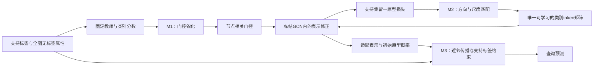

# 冻结图模型的少样本适配：语义分配、尺度匹配与结构读出

写作日期：2026-09-25。基于主线03和三底座统一协议对比的现有实验重构论文叙事，不新增训练，不替换原始记录。主结果使用统一协议下的1680条记录；早期确认实验承担机制分析与边界分析，分别标注，不能混表配对。本文件为写作方案与正文草稿，不构成新的方法原创性检索结论。

## 1. 全文应让读者记住什么

**在冻结图模型的少样本适配中，有限监督如何被分配到提示、如何驱动提示更新、如何约束最终预测，是三个相互衔接而又可以分别检验的设计问题。对同一条适配流程的干预，可以产生稳定的整体收益，但各环节的增益与预训练底座及数据条件有关。**

这是本研究最适合承担的核心命题。它同时包含一个方法观点和一个实证发现：方法观点是把适配分解为条件分配、参数更新与预测读出；实证发现是同一设计在不同冻结checkpoint上的作用并不一致。

建议论文题目使用本文件标题；若作为硕士论文章节，可用“面向少样本节点分类的三阶段图提示适配”。“三阶段”描述作用环节，不表示三个模块都端到端训练。不要在标题中使用“通用最优”“全面协同”“自适应选择”：现有实验没有证明这些性质，当前系统也没有按底座自动选择模块的算法。

与已有叙事相比，本稿进一步强调两个关系：一是模块之间的功能衔接，二是实验中的作用差异。前者解释为什么这样设计，后者决定可以把方法推广到多大范围。全过程中的“监督传递”是一种组织视角，没有测量信息流失量，也没有证明信息论意义上的传递定理。

## 2. 先呈现一个值得研究的现象

参数量和插入位置相同的类别条件Prompt，在切换门控温度、优化方式或最终读出后，性能会发生变化；这种变化在不同冻结底座上幅度不同。统一协议恰好提供了可比的观察窗口：Cora、CiteSeer，三个预训练家族的六份固定checkpoint，每类5个支持节点，20个共同支持seed，100次更新。

下表全部来自最新统一协议，Accuracy单位为%，增量单位为百分点。F000是已有条件Prompt基础，F111是三个开关全部开启。M1/M2/M3列分别为F111减去F011/F101/F110。

| 数据集 / 底座 | F000 | F111 | 整体增量 | M1移除差 | M2移除差 | M3移除差 |
|---|---:|---:|---:|---:|---:|---:|---:|
| Cora / Edgepred_Gprompt | 71.995 | 74.205 | +2.210 | -0.060 | +0.820 | +0.395 |
| CiteSeer / Edgepred_Gprompt | 63.490 | 67.765 | +4.275 | +1.555 | +0.460 | +0.630 |
| Cora / Edgepred_GPPT | 68.505 | 71.615 | +3.110 | +2.145 | -0.060 | +0.670 |
| CiteSeer / Edgepred_GPPT | 58.640 | 65.280 | +6.640 | +5.440 | +0.185 | +0.530 |
| Cora / DGI | 32.415 | 51.230 | +18.815 | +8.900 | +12.095 | +2.230 |
| CiteSeer / DGI | 32.625 | 48.620 | +15.995 | +8.130 | +11.260 | +2.450 |

六格整体增量的配对95%区间下界均为正；六格M3增量的区间下界也均为正。M1在Cora/Edgepred_Gprompt、M2在两个Edgepred_GPPT格和CiteSeer/Edgepred_Gprompt的区间跨零。只有DGI两格的三个移除差区间均正。[S1–S3]

最值得展开的观察是：**模块作用最强的底座，未必给出最高的最终性能。** DGI两格的模块作用大，但完整方法分别低于本轮GPrompt 4.260和9.865个百分点。反过来，Edgepred_Gprompt上的Cora取得74.205%，却没有得到M1稳定增益的证据。内部改进空间、完整方法绝对性能和外部竞争力应分别讨论。

这些现象可以在引言末尾预告，在实验中完整展开。它们是在前期探索和确认后得到的观察，写作时不应虚构成研究开始前已经完成的独立动机实验。

## 3. 从一个总问题自然引出三个模块

总问题是：**只有少量支持标签且主干不能更新时，如何让这些标签形成节点相关、能够学到、并可用于最终分类的表示修正？**

### 3.1 第一步：有限类别监督如何成为节点相关的修正条件

类别token提供了一组任务相关的可学习修正，但不同节点需要怎样组合这些token，仍需要确定。本文用支持标签和无标签属性构造固定教师，并由其类别分数产生门控。M1在这个已有条件提示基础上降低门控温度，以调整节点对类别token的相对分配。

可用于方法段落的写法：

> 我们首先考虑类别监督在节点间的差异化作用。对同一任务共享的类别提示，节点需要根据自身与支持类别的关系获得不同修正。为此，我们在固定教师提供的类别条件上引入温度锐化，调整节点对类别提示的组合权重，并将生成的修正注入冻结编码器的中间表示。

必须保留的技术精度：F000已经有教师、类别token和普通温度门控；M1新增的是温度0.2到0.1的切换。锐化保持教师分数的类别排序，源码还断言argmax不变，因此不能说它“纠正了教师分类”。门控随后中心化并经邻接传播，实际可以有负值，不能把最终修正描述为概率凸组合。raw锐化同时改变分配形状与幅度。[S8]

### 3.2 第二步：给出了修正条件，如何在有限预算内学好提示

M1确定节点如何组合提示，但不确定提示矩阵如何被更新。类别token的梯度具有类别轴和特征轴；矩阵预条件改变方向，也会改变方向的范数。M2使用左右梯度统计构造更新方向，再将范数匹配到同一实际梯度序列上的Adam候选方向。

承接前一模块的写法：

> 节点相关的条件分配只规定提示修正的作用方式，实际修正仍取决于提示参数的学习。考虑到类别提示具有矩阵结构，我们进一步利用类别轴与特征轴的梯度统计调整更新方向，并以Adam候选方向提供步幅参照，使方向选择与更新尺度分别受到控制。

这是一种固定更新预算下的优化设计；现有实验没有证明它降低了总体样本复杂度，也没有给出收敛速度定理。完整矩阵优于对角近似只在部分配置得到支持。Shampoo与范数匹配采用已有原子技术，不能把重新命名当作算法首创。[S4–S6、S8]

### 3.3 第三步：得到适配表示后，如何让支持标签继续约束预测

支持原型分类为每个节点产生类别分数，但该读出没有显式约束相邻表示的预测关系。M3在本次适配表示上构建50近邻图，传播原型概率，并在每一步固定支持节点的标签。

承接前一模块的写法：

> 学习得到的表示最终还需要转化为查询节点预测。极少支持样本下，逐节点原型判别可以进一步结合表示空间中的邻域关系。我们因此在适配表示上构建近邻图，以原型概率为初始状态进行传播，并持续施加支持标签约束，使有限监督在最终读出阶段仍能发挥作用。

M3是训练后的结构读出，不进入Prompt损失或反向传播。编码器和教师之前已经利用图结构，不能说M3“首次引入结构”。相似表示也不必然属于同一类别；Actor/GraphCL的早期负格限制了推广范围。[S4、S8]

### 3.4 三者为什么属于同一项研究

它们沿同一个对象衔接：M1生成条件矩阵，用来组合唯一可学习的token矩阵；M2更新这组token；M3读取由这组token修正后的表示。共享一个冻结两层GCN，不存在三个编码器或三个预测器投票。

这里“组合合理”来自功能依赖；“组合有效”需要实验；“统计协同”需要交互项证据。这三种判断不能相互替代。

## 4. 可直接用于引言的五段正文

图上的少样本节点分类要求模型利用极少的任务标签对大量未标注节点进行预测。冻结预训练编码器并学习少量提示参数，为这一任务提供了参数高效的适配途径。在这种设置下，任务监督需要通过有限的可学习自由度影响节点表示，并最终形成查询预测。因此，如何组织监督对适配过程的作用，是决定提示学习效果的重要设计问题。

本文将这一问题具体化为三个环节。首先，共享的类别提示需要根据节点与支持类别的关系，形成节点相关的表示修正。其次，即使修正方式已经确定，提示参数仍需在有限更新预算下获得合适的方向和步幅。最后，训练得到的表示需要转化为预测，支持标签与节点关系如何参与读出也会影响最终结果。这三个环节共同构成本文考察的适配流程，其作用应通过匹配对照分别检验。

基于这一视角，本文构建语义分配、尺度匹配与结构读出相衔接的图提示适配方法。在条件分配阶段，对支持类别教师产生的门控进行温度锐化，调整节点对类别提示的组合方式；在参数更新阶段，利用类别轴与特征轴的梯度统计构造矩阵预条件方向，并匹配同轨迹Adam候选更新的范数；在预测阶段，基于适配表示构建近邻图，结合支持标签约束传播原型概率。整个流程保持图编码器冻结，仅优化一组类别提示参数。

我们在Cora和CiteSeer的三类预训练来源、六份固定checkpoint上进行统一协议评估，使用每类5个支持节点、20个共同支持采样seed与100次更新。完整方法相对已有条件提示基础，在六个配置中均获得正的Accuracy配对增量，范围为2.210至18.815个百分点。但组件收益并不均匀：门控锐化与矩阵更新的作用随checkpoint和数据集变化，而支持约束传播在本轮六个配置中均呈现正的移除差区间。对照实验进一步显示，较大的内部模块增益并不必然带来更强的外部竞争力。

本文的研究贡献在于组织并评估有限监督作用于冻结图模型的三个环节，以及用组件替代、全因子组合和统一协议比较明确其有效范围。实验支持特定条件下的系统改进，同时保留直接教师更强、组件增益不稳定以及不同指标方向不一致的结果。这使方法的整体收益、组件作用和机制解释能够被分别审视，也为后续针对不同冻结表示的适配设计提供具体依据。

正式投稿或提交论文时，应在第一、二段补入经原文核对的相关工作引用。本稿没有新增查新，不将“采用三个环节组织研究”表述为穷尽文献后确认的领域空白。

## 5. 实验按读者的问题展开

### 问题一：完整流程是否改善了已有条件提示

用统一协议的F000/F111回答，报告六格完整结果和配对区间。主文必须交代F000包含教师、条件Prompt、Adam和共同输出中心化。六格整体增量支持三个开关组成的系统在本轮范围内有改进；不能把相对冻结模型或外部弱基线的全部增量归给这三个开关。

过渡句：“整体收益仍无法说明三个环节是否都不可缺少，因此进一步固定其余设置，只移除一个操作。”

### 问题二：不同环节分别在什么条件下有作用

用本文件第2节的移除差表及区间回答。建议把“底座 × 模块”的效应图放在主要位置，正文解释三个现象：M1在Cora/Edgepred_Gprompt接近零，M2在Edgepred_GPPT未确认独立增益，M3在本轮六格呈现一致正向贡献。

早期CiteSeer/Edgepred_Gprompt中M2为+0.895，区间[+0.210,+1.735]；新统一轮为+0.460，区间[-0.025,+0.950]。两个估计同为正且区间重叠，应写“新seed组下证据强度减弱”，不能说机制已被否定，也不能只保留旧轮的正区间。[S1、S4]

过渡句：“移除操作改变了多个因素，下面进一步检验更简单的解释。”

### 问题三：锐化是否只是放大幅度，矩阵优化是否只是改变步长

使用早期确认轮的机制对照，明确标注seed块与最新主结果不同。

M1比较普通门控、raw锐化、等范数锐化、仅幅度变化。在CiteSeer/Edgepred_GPPT中，完整方法分别超过等范数锐化2.030和仅幅度变化2.315个百分点，两项区间均正；Cora/Edgepred_Gprompt中，完整方法比仅幅度对照低0.355，区间跨零。因此，部分配置的结果与“形状和幅度共同起作用”的解释一致，但不能推广为纯粹的语义准确性改善。[S4–S5]

M2比较Adam、匹配矩阵、匹配对角和无匹配矩阵。Cora/Edgepred_GPPT中，完整矩阵比对角版本低0.455，区间[-0.745,-0.165]；DGI两格中，完整矩阵比对角版本分别高3.475和3.710，区间下界均正。无匹配版本较差只说明当前步长配置下范数处理很重要，不能证明经充分调参的无匹配优化器必然较差。[S5–S6]

已有梯度条件数与有效秩属于描述性诊断。DGI并没有表现出所有条件数都最大的简单规律，不应将其收益直接归结为“DGI条件数最大”。[S7]

### 问题四：三个模块是否产生超出简单叠加的协同

使用早期八格全因子结果。对M3固定开启时的M1/M2交互，定义

$$
I_{12\mid 3=1}=\mathrm{Acc}_{111}-\mathrm{Acc}_{101}-\mathrm{Acc}_{011}+\mathrm{Acc}_{001}.
$$

早期DGI两格的该交互为+3.680 [+1.225,+6.010]和+4.515 [+1.685,+7.345]，支持这些具体配置中的正向交互；Edgepred_Gprompt两格分别为-0.690 [-1.410,-0.025]和-0.985 [-1.705,-0.280]，呈现收益重叠或次可加的表现。负交互并不等于加入组件一定使性能下降，应与条件移除差分开解释。[S4、S6]

可写“功能衔接与条件性交互”，不能写“三模块普遍协同”。最新统一轮只有000、011、101、110、111五格，不能用它计算完整八格交互；上述交互来自早期各轮，不能做跨轮同seed差异检验。

### 问题五：内部收益是否转化为相对现有方法的竞争力

放14方法的完整统一协议表，必须展示DGI失败格。四个Edgepred配置中，完整方法高于本轮九项外部对照的平均Accuracy；DGI两格落后于GPrompt。该结果限于当前固定超参数、100更新和各方法自己的输入/读出机制。

多项移植基线偏低，尚未完成等额支持集调参和收敛检查。DAPrompt-fixed只覆盖固定底座上的提示阶段。因此这些比较不能用于断言超过原论文最好结果，也不能证明某个原方法失效。[S1]

### 问题六：直接使用教师是否已经足够

这是目前最重要的竞争性问题，应进入正文讨论，不能仅藏在附录。早期Edgepred_Gprompt确认轮，Cora完整方法超过未中心化直接教师1.885个百分点；CiteSeer却低于中心化直接教师2.100个百分点。DGI两格完整方法低于未中心化直接教师21.920和20.915个百分点。[S4、S6]

此外，早期CiteSeer/DGI的F000仅32.535%，低于冻结原型45.700%；F111为47.340%，相对冻结原型增量1.640的区间[-0.825,+4.140]跨零。因此，DGI中相对F000的大收益包含恢复本条件提示基础损失的可能，不能全部解释为成功释放了预训练知识。[S6]

最新统一轮没有重跑直接教师，不能把早期教师均值与最新F111数值直接拼成配对表。当前应表述为“教师到冻结模型的适配在部分配置有效，但优于直接教师的普遍价值尚未建立”。

### 问题七：效果边界和代价是什么

早期Actor/GraphCL上F111相对F000仅+0.211，区间[-0.250,+0.681]；其M3均值为负且区间跨零。这个结果限制了本方法跨数据类型推广，但单个数据集与checkpoint不能独立证明异配性是失败原因。[S4]

最新统一轮加入M1后，Cora/Edgepred_Gprompt的AUC下降0.575、AP下降1.277；Cora/Edgepred_GPPT的AUC下降0.221，三项区间均为负。分类准确率和类别分数排序可以出现不同方向，AUC/AP也不是概率校准指标，不能据此声称已测量或改善校准。[S1–S3]

仅训练C×128个参数，Cora为896、CiteSeer为768。但矩阵分解、CPU/GPU传输与近邻搜索有代价；精确近邻构建仍含二次规模计算。报告实际成本并使用“参数高效”，不将其直接写成“计算成本可忽略”。[S7]

## 6. 主图、主表与章节安排

| 图表或章节 | 承担的论证职责 | 推荐内容 |
|---|---|---|
| 图1：适配流程图 | 让读者看懂监督如何作用于同一组参数及最终预测 | 第3节流程；标明冻结主干、固定门控、唯一可学习矩阵、训练后传播 |
| 表1：协议与来源 | 给比较范围定界 | checkpoint SHA、共同seed、5-shot、100更新、转导访问、移植范围 |
| 表2：完整结果 | 回答整体效果与外部竞争力 | 14方法六格结果；内部/外部对照分组；保留DGI负格 |
| 图2：组件效应 | 显示贡献随配置变化 | 六格移除差及配对区间；不用只有正值的筛选图 |
| 表3：机制替代 | 区分操作效果与解释 | 等范数/仅幅度门控、对角/无匹配更新；标注早期轮次 |
| 图3：组合交互 | 区分功能衔接与统计协同 | 早期八格因子与条件交互，不和最新五格混算 |
| 表4：直接教师与冻结对照 | 检验使用完整适配的额外价值 | 早期同轮配对；单独列出最新统一轮尚缺该对照 |
| 讨论与成本 | 界定可推广范围 | Actor、排序指标负效应、支持采样范围、计算代价 |

正文顺序建议为：问题与观察 → 共享基础 → 三个作用环节 → 协议 → 整体效果 → 条件性模块贡献 → 替代解释与交互 → 直接教师和适用边界。工程修复历史、逐预测审计日志和全部超参数放附录，主文保留影响科学结论的协议差异。

## 7. 可直接采用的摘要草稿

在少样本节点分类中，冻结预训练图编码器并学习少量提示参数提供了一种参数高效的适配方式，但类别监督如何作用于提示分配、参数更新和最终读出仍需要分别设计与检验。本文围绕这三个环节构建三阶段图提示适配流程：通过教师门控锐化调整节点对类别提示的组合，通过Adam范数匹配的矩阵预条件更新提示参数，并在适配表示上进行支持标签约束的近邻概率传播。在Cora和CiteSeer的六份固定预训练checkpoint上，采用每类5个支持节点、20个共同支持采样seed及100次更新，完整方法相对条件提示基础的Accuracy提升为2.210至18.815个百分点。组件分析显示，门控与优化收益依赖具体底座，而概率传播在本轮六个配置中均产生正向配对增量。统一协议比较与早期直接教师对照进一步表明，内部模块收益并不保证外部领先。研究据此明确了该适配流程的条件性效果及其证据边界。

## 8. 三条贡献应这样写

1. **适配流程的组织。** 面向冻结GCN的转导少样本节点分类，将节点相关提示分配、提示参数更新和支持约束读出组织为共享同一组类别token的处理流程，明确各组件作用对象及训练边界。
2. **具体设计与替代验证。** 实现门控温度锐化、Adam尺度匹配的矩阵更新和适配空间概率传播，利用幅度控制、对角替代及全因子对照检验其增量与条件性交互。贡献是任务适配和实证，不宣称原子算法首创。
3. **条件性证据。** 在匹配checkpoint与支持采样的协议下，区分整体收益、组件贡献和外部竞争力，呈现模块作用随配置变化、直接教师优势及部分指标负效应。结论限定到实际权重和同图支持采样。

现有材料足以组织为一项证据边界清楚的硕士论文章节。是否构成高水平会议所需的方法创新仍需单独判断；三项工程设计或大量结果不能自动成为三项独立原创贡献。

## 9. 若要增强主张，优先补哪三项证据

以下是未来工作建议，本次未执行，也不影响交付现有证据下的叙事。

1. **最高优先级：在最新共同seed上补直接教师与冻结对照。** 将中心化/未中心化教师、冻结原型与完整方案放在同轮，并加入无预训练或随机冻结权重对照。先回答是否值得经过冻结模型适配，再讨论预训练知识的额外贡献。
2. **增强机制：在预先锁定的配置中区分门控形状与幅度。** 沿用已有普通/锐化与幅度控制，并联合报告门控熵、门控范数、隐藏修正幅度及性能；诊断应先给预期，不能只在结果出现后命名为语义改善。M2优先补等预算学习率/收敛对照，避免把100步下的尺度不合适误写成算法必然不足。
3. **增强竞争力：对少数最有代表性的强对照做等额支持集调参。** 同时预先锁定新增checkpoint或数据集检验范围。由支持集内验证/留一准则决定配置，不按query选择模块；不存在已验证的自动模块选择规则时，不发布“按底座自适应选择”结论。

## 10. 证据与核查记录

本次读取了研究设计、现有叙事、方法章节、三个确认轮、统一协议结果、成本与梯度诊断，并检查门控与优化源码及统一runner。重新聚合all_metrics.json的1680条记录：84个数据集/底座/方法组，每组20个seed；同格各方法的支持/查询划分哈希一致。重算all_metric_pairs.json全部420组指标均值和完整方法配对差，最大浮点差约1.42e-14。该检查是记录层汇总核验，不声称本次重新执行所有GPU训练或重算所有封存张量。已有metrics_transport_verified.json记录1680条本地复核通过。

复核主结果使用规范概率评估后的记录；旧的12方法文档对应1440条，新增MTG和DAPrompt-fixed后为14方法1680条，不将两者误报为重复实验。

证据入口：

- [S1 最新结论与完成状态](../三底座统一协议对比_20260924/结论与完成状态.md)
- [S2 逐次指标记录](../三底座统一协议对比_20260924/all_metrics.json)、[全部多指标配对统计](../三底座统一协议对比_20260924/all_metric_pairs.json)
- [S3 统一协议与移植说明](../三底座统一协议对比_20260924/机制与协议说明.md)、[完整多指标表](../三底座统一协议对比_20260924/统一协议多指标对比.md)
- [S4 Edgepred_Gprompt与Actor确认结果](stage2_confirmation/确认结果.md)
- [S5 Edgepred_GPPT确认结果](stage2b_gppt_confirmation/确认结果.md)
- [S6 DGI确认结果](stage2c_dgi_confirmation/确认结果.md)
- [S7 梯度诊断](chapter_assets_final/梯度诊断.md)、[成本表](chapter_assets_final/成本表.md)
- [S8 方法定义](论文章节初稿.md)、[门控实现](../三底座统一协议对比_20260924/sources/主线03_CiteSeer_锐化门控Prompt与步长匹配/gate79.py)、[优化实现](../三底座统一协议对比_20260924/sources/主线03_CiteSeer_锐化门控Prompt与步长匹配/optimizer83.py)、[实际训练与前向](../三底座统一协议对比_20260924/sources/主线03_CiteSeer_锐化门控Prompt与步长匹配/run_round83_graft.py)、[统一runner](../三底座统一协议对比_20260924/grid.py)

20个seed是同一图上的支持采样，不是20张独立图。三底座经过历史探索筛选，早期各确认轮seed块不同，bootstrap区间未校正多重比较。底座来源为本地适配权重，代码与哈希核对不等于原论文完整复现。全文中的条件依赖指观测到的配置差异，不能仅凭每个家族的单份权重将差异因果归结为预训练目标。
