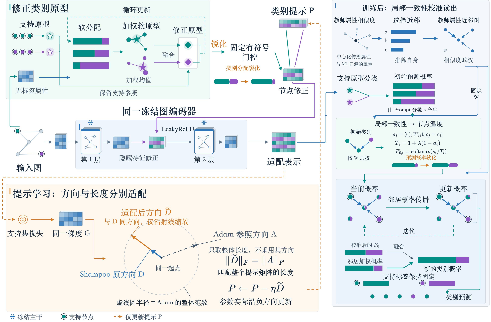
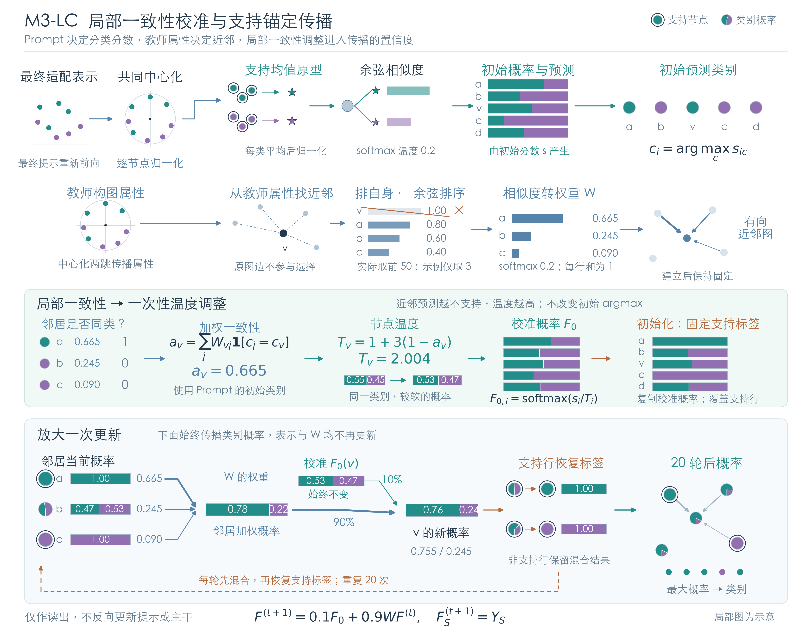

# CGRPrompt：类别引导残差提示

> 当前定稿叙事。整体方法称为CGRPrompt（Class-Guided Residual Prompt）；M1、M2、M3分别是同一个提示结构的构造、学习与读出环节。正式M3采用M3-LC，不包含模型集成或OOF误差校正。研究范围为Cora、CiteSeer上的两种边预测预训练冻结GCN，采用每类5个支持节点的分类协议。

## 1. 核心故事：用类别关系组织修正，再约束修正后的预测如何传播

**CGRPrompt以支持类别组织共享残差：固定节点如何组合类别残差，学习这些残差的内容；在得到适配后的分类分数后，再根据属性邻域的支持程度调整其进入传播的置信度。**

这条叙事从一个具体的结构选择出发。少样本分类已经提供了类别及其支持节点，因此可以用这些类别组织提示基底，而不必再从少量标签中同时学习一套节点分配网络。不同节点按照各自的类别关系组合共享基底，得到不同的隐藏层修正；可学习参数仍集中在一个类别数乘隐藏维度的矩阵中。

但类别关系只能提供适配的条件，不能直接替代适配后的分类结果；分类结果的置信度也不能直接当作传播依据。因此，完整方法沿着同一条计算链处理三个具体问题：类别残差怎样分配给节点，残差矩阵怎样更新，更新后的分类信号怎样被邻域利用。M3承担最后一个环节，其输入仍是同一个Prompt产生的分数。

论文先用这段结构定义建立总叙事，再由方法与实验逐步回答“为什么采用这些具体选择”。三个环节的功能衔接来自计算结构；它们是否带来额外收益，由各自的匹配对照回答，不把模块数量本身当作贡献数量。

### 当前 Framework 图

[中英文高清图、SVG、可编辑 Draw.io 与论文图注](Framework_M3LC_原版风格_20260927/图注与文件说明.md)。总图中的虚线仅表示提示学习；M3图沿用原版符号，以 $ F_0 $ 表示固定校准概率、$ F^{(t)} $ 表示迭代状态。

## 2. M1：为什么固定类别分配，只学习类别残差

### 2.1 结构选择与已有方法的关系

节点相关提示已有先例。例如GPF+通过提示基向量和注意力生成节点相关的输入提示。CGRPrompt考察的是另一组具体选择：**基底按下游支持类别组织，组合系数由固定类别关系产生，修正注入冻结编码器的隐藏层。** 区别应落实在这些可核查的机制上，而不是声称已有方法没有考虑节点差异。[GPF/GPF+原论文](https://arxiv.org/abs/2209.15240)

记固定类别条件矩阵为 $ Q\in\mathbb R^{N\times C} $，可学习类别残差为 $ P\in\mathbb R^{C\times d} $。核心修正形式为

$$
\Delta U=10\,[Q\tanh(P)]\odot s_U.
$$

其中，$ U $ 是冻结第一层产生的预激活表示，$ s_U $ 为隐藏维度尺度参照。将 $ U+\Delta U $ 送入非线性和后续冻结图层，得到适配表示 $ Z_P $。唯一学习的提示矩阵是 $ P $，其参数量为 $ Cd $，不随节点数量增长。零初始化使提示从无额外修正开始；有界变换与尺度参照控制修正幅度。

固定分配的理由是让少量标签主要用于学习修正内容，避免同时估计额外分配器。相应代价也很具体：错误的类别条件可能把修正分配给不合适的节点，类别基底也会约束可表达的修正。参数量是结构事实；是否因此更适合当前任务，必须看固定、可学习、置乱等分配对照，不能仅由参数少推出泛化更好。

### 2.2 为什么采用中心化和锐化

类别条件来自支持原型与可见无标签传播属性的原型精炼。无标签软分配补充每类少量支持点的信息，原支持原型保留类别参照。这里的教师本身就是一个强分类器，因此实验还必须比较“直接使用教师”与“用教师条件组织Prompt”的差别。

令教师分配为 $ \Pi $，实际门控先减去全图平均分配，再经归一化原图传播形成 $ Q $。中心化让节点的**相对类别偏好**参与残差组合，减少全图共有分量带来的同向修正。若所有节点分配相同，中心化门控为零；若所有类别的变换后残差相同，因类别系数之和为零，这一共同分量也会抵消。

锐化作用于类别分配，改变不同残差的组合强度与相对权重。因此，它的设计理由是增强已有类别偏好对残差组合的作用，而不是提高教师初始类别判断的准确率。正温度缩放不改变原始分数的argmax；等范数锐化和仅幅度控制，才用于区分组合形状与幅度的作用。

当前证据支持这种作用具有配置依赖性，不能说所有设置都需要相同锐化。具体机制对照见[补验报告第6节](../CGRPrompt_叙事补验_20260926/最终研究结论与叙事_20260927.md)。

## 3. M2：为什么围绕同一个类别残差矩阵设计更新

M2直接学习上述 $ P $，并不新增另一套提示。对中间乘积 $ V=Q\tanh(P) $，有

$$
\frac{\partial\mathcal L}{\partial P}
=\left(Q^\top\frac{\partial\mathcal L}{\partial V}\right)
\odot\left(1-\tanh^2(P)\right).
$$

这个表达说明，多个节点通过同一个类别条件矩阵共同更新残差；类别行与隐藏特征列的梯度可能相关。因而，在更新时利用这两个轴的矩阵统计，有直接的结构依据。

当前方案采用Shampoo方向，并将其整体范数匹配到同轨迹Adam候选方向：矩阵统计决定更新方向，Adam方向的范数提供步幅参照。这解释了为什么同时保留“方向处理”和“尺度参照”，也使对角替代、去除范数匹配、Adam及等预算调参成为必要对照。[Shampoo原论文](https://arxiv.org/abs/1802.09568)

这里采用的是已有优化原语。梯度具有矩阵结构并不能推出完整矩阵更新必然最优；已有对角替代和调参结果也不支持这种普遍结论。论文应将M2写成与类别残差参数化相配合的学习规则，其价值由当前协议中的实测结果支撑，不单独包装成一种新优化算法。

## 4. 新M3：分类表示、传播关系与传播置信度分工

### 4.1 为什么用Prompt表示分类，却用教师属性构图

适配表示用于区分类别，传播图用于组织节点之间的信息交换。这两项功能不要求使用同一种距离。原始M3在适配表示上构建近邻图；保持训练与初始分类分数不变，仅替换为中心化两跳属性近邻图后，已有配对实验得到重复改善。因此，最终M3保留Prompt的分类分数，采用教师属性构建传播关系。

这里“教师图”只表示构图属性的来源，不表示用教师分类分数替换Prompt预测。它是训练后的读出图，也没有替换冻结GCN内部使用的原图。论文中不能再使用“适配后的关系必然更符合任务，所以应该用它构图”的旧理由。

### 4.2 为什么还需要局部一致性校准

即使构图属性不变，初始分类分数仍可能对某个类别给出较强偏好，而相邻节点的预测并不支持这个判断。直接传播这些概率，会将相同置信度刻度用于不同程度的邻域一致性。新M3为此加入一个固定规则：**在传播前，降低邻域较少支持的初始预测的置信度，再让图传播和已知支持标签参与最终判断。**

令 $ s_i $ 为Prompt初始分类分数，$ c_i=\arg\max_c s_{ic} $，$ W $ 为教师属性图的行归一化边权。定义

$$
a_i=\sum_j W_{ij}\mathbf{1}[c_j=c_i],
\qquad T_i=1+3(1-a_i),
\qquad P_i^{(0)}=\operatorname{softmax}(s_i/T_i).
$$

一致性比较的是**教师属性邻居上的Prompt初始预测**，不是教师分类器与Prompt是否一致。$ a_i $ 高时，温度接近1；$ a_i $ 低时，温度增大，概率变软。温度只由初始预测计算一次，正温度不改变传播前的argmax，也不增加可训练参数或Prompt拟合次数。

随后进行支持锚定的传播：

$$
P^{(t+1)}=0.1P^{(0)}+0.9WP^{(t)},
\qquad P_S^{(t+1)}=Y_S,
\qquad t=0,\ldots,19.
$$

初始状态也固定支持节点标签。每轮回注保留初始分类信号，支持锚点使已知标签不被传播覆盖。固定配置为去自环余弦50近邻、近邻softmax温度0.2、20步传播。温度系数3与这些常数是经实验采用的配置，不为其数值编造理论必然性。

局部一致性是可计算的邻域支持信号，不是真值可靠性的保证：邻居也可能共同判断错误。本方法中的“校准”指这项温度调整，不能据此宣称概率已满足统计校准或错误传播已被消除。

### 4.3 为什么M1锐化与M3软化并不矛盾

M1调整的是**教师类别分配如何组合残差**，用于生成隐藏层修正；M3调整的是**训练后的Prompt分类分数如何进入传播**。前者让类别偏好更充分地作用于提示，后者对缺少邻域支持的判断适度降低置信度。它们面对不同的变量、发生在不同阶段，不能用一句“统一提高置信度”概括，也不能把两个温度当成同一超参数。

## 5. 实验怎样逐步支撑这条叙事

实验的作用是回答设计选择，而不是给每个模块配一张涨点表。

| 要回答的问题 | 关键比较 | 可支持的结论 |
|---|---|---|
| 类别条件怎样影响残差组合？ | 固定/可学习/置乱条件，等范数锐化，仅幅度替代 | 区分类别对应、组合形状与幅度的作用 |
| 矩阵更新是否有额外价值？ | Adam、匹配对角、去尺度匹配及等预算调参 | 区分方向统计、步幅与调参预算的作用 |
| 分类表示是否必须兼任构图表示？ | 原始适配表示图与教师属性图，其他条件相同 | 检验关系来源的替换，而非把训练变化混入结论 |
| 局部校准是否优于原图传播？ | 新M3与M3-T | 检验校准的增量 |
| 是否只是统一软化即可？ | 相同平均温度、固定温度、打乱节点温度 | 检验节点对应关系是否提供额外信息 |
| Prompt是否超过同信息直接预测？ | 中心化/不中心化教师，不传播/固定传播及同操作教师 | 区分组件改善与外部竞争力 |

旧F000基线已经包含类别条件残差，不能把F000到完整方法的差值解释成整套类别残差参数化相对GPF+的优势。历史三模块移除实验若使用旧M3，也不能直接改名为新M3消融。最终完整方法及其对照应使用真实运行新M3的预测；历史数字保持原方法标签。

### 5.1 新M3的直接证据

以下完整列出第5轮同一批20次支持抽样的Accuracy，不跨轮拼接最优值。旧版M3只在此作为历史对照，正文默认M3均指局部一致性校准版本。

| 数据集/预训练 | 原始M3：适配表示图 | M3-T：属性图、无局部校准 | 新M3：M3-LC | 校准增量（百分点） |
|---|---:|---:|---:|---:|
| Cora / Gprompt | 74.305 | 75.715 | 76.090 | +0.375 |
| Cora / GPPT | 71.745 | 74.610 | 74.910 | +0.300 |
| CiteSeer / Gprompt | 68.510 | 69.660 | 69.755 | +0.095 |
| CiteSeer / GPPT | 66.425 | 69.660 | 69.835 | +0.175 |

该批新M3相对M3-T平均提高0.23625个百分点，四组均值均提高，Cora两组配对区间为正。第6轮另20次支持抽样中，同一冻结规则平均提高0.23125个百分点。两批结果支持采用这一简洁增量；不能把四组均值为正改写成四组都统计显著。[第5轮确认](../CGRPrompt_M3持续优化_20260927/round05/确认结果.md)；[第6轮复核](../CGRPrompt_M3持续优化_20260927/round06/确认结果.md)

### 5.2 为什么是节点级温度，而不只是把概率整体变软

在两批封存分数的机制重放中，与全图采用相同平均温度相比，局部温度在Cora/Gprompt两批分别多提高0.235、0.145个百分点，在Cora/GPPT分别多提高0.385、0.235个百分点，四个配对区间均为正。这支持Cora上节点对应关系具有额外价值。CiteSeer的相应区间跨零，不能把这一机制结论推广到全部设置。

这项分析复用已看过结果的缓存，属于事后机制诊断，不是第三批独立确认。匹配平均温度也不等于匹配输出熵。[机制重放](../CGRPrompt_M3持续优化_20260927/calibration_diagnostic/结果.md)

### 5.3 属性原型分支的作用与Prompt适配的增量

此前使用的“强直接教师”指项目内部构造的属性原型预测对照，不是某篇论文的正式方法名称，也不是已经确认由他人提出的完整同款方案。它在两跳传播属性上计算支持类原型，利用无标签节点的软分配精炼原型，再直接进行类别预测；实验分别保留属性中心化与不中心化版本，以及不传播、固定传播等读出设置。“强”仅描述当前实验表现，不表示公认最优算法。

这一分支本身属于方法设计的重要内容：其类别关系为M1组织类别残差，其属性表示为M3构建传播图。直接预测效果较好，说明属性原型路径值得保留和研究；不应将它描述为否定整个方法的外部裁判。论文可将其明确表述为“属性原型类别条件构造”，解释如何从少量标签与可见无标签属性获得节点—类别关系，并怎样服务于隐藏层提示和最终读出。

图属性传播与无标签原型修正各有已有研究，例如[SGC](https://proceedings.mlr.press/v97/wu19e.html)和[Prototype Rectification](https://arxiv.org/abs/1911.10713)。这些工作是相关原语的先例，不能据此断言本项目的完整配方已被发表，也不能仅凭当前有效就断言完整配方首次提出。贡献判断应针对具体构造及其与Prompt的连接方式展开。

保留直接预测对照，是为了量化在这条有效属性路径上进一步进行Prompt适配的增量。它可以作为内部路径对照，与已有发表方法的外部比较分别报告。第5轮Cora/Gprompt支持进一步适配的收益，其他部分设置两条路径接近；因此当前结果同时呈现属性原型分支的价值和完整适配流程的增量，而不要求每个组成环节在每个设置中都单独取胜。若要主张Prompt适配带来额外优势，仍应由相应配对结果支撑。

## 6. 可直接用于引言的方法叙事

在边预测预训练模型的少样本节点分类适配中，支持节点不仅提供监督标签，也给出了当前任务的类别组织。已有图提示方法通过共享提示或节点相关组合实现参数高效适配。本文考察以支持类别组织隐藏层残差的提示形式：利用节点与当前类别的关系分配修正，使不同节点获得不同适配，同时将需要学习的参数集中在一个类别残差矩阵中。

基于这一思路，我们提出CGRPrompt，即类别引导残差提示。该结构以支持原型和可见无标签属性估计节点的类别关系，将关系固定为提示组合条件，仅学习各类别对应的共享残差。通过中心化与温度调整，节点相对图平均的类别偏好参与残差组合；针对同一个类别残差矩阵，采用带有步幅参照的矩阵预条件更新，学习冻结编码器内部的节点修正。

适配后的分类表示并不必然提供最合适的传播关系。我们在保持训练及分类分数不变的对照中发现，属性关系读出优于原适配表示构图，并进一步引入局部一致性校准：根据属性邻域对Prompt初始预测的支持程度调整节点温度，再通过初始概率回注和支持标签锚定完成预测。由此，类别条件、残差学习与预测读出共同构成一套完整的Prompt适配流程。

我们在Cora、CiteSeer及两种边预测预训练设置下，通过匹配替代、组件消融、新支持抽样复核和强直接教师对照检验这一设计。实验支持属性关系读出与局部校准的作用，并区分了已确认的组件改善、配置相关的机制证据及尚未稳定超越强教师的情形。

## 7. 写作口径与证据管理

方法名称固定为“CGRPrompt：类别引导残差提示”。贡献先陈述具体结构及其作用，再用实验限定成立范围，不以三个模块各自解决一个宽泛问题作为论证。中心化、锐化、矩阵预条件与温度传播有各自先例；可主张的是本方法的具体组织方式及验证结果，不能把采用已有原语写成首次提出该原语。

本文研究范围按已有实验确定为两张图与两种边预测预训练；该选择过程在协议中说明，不新增DGI实验，也不由此推断其他预训练方法无效。新的支持抽样来自同一张图，不等于独立图泛化。方法在明确范围内成立，不要求覆盖所有数据集和预训练类型；同时完整报告既定范围内的所有设置。

M3-LC已经定稿，停止结构搜索。模型集成、OOF校正及其他未采用路线保留在探索档案，不作为当前完整方法的组成部分，也不再把它们的探索过程插入引言。本文中的M3-T仅作去掉局部校准的消融；“原始M3”专指历史适配表示图版本。

- [新M3固定定义与实现](../CGRPrompt_M3持续优化_20260927/定稿/新M3方案定稿.md)
- [M1/M2补验与完整证据](../CGRPrompt_叙事补验_20260926/最终研究结论与叙事_20260927.md)
- [类别残差参数化的历史详细推导](CGRPrompt_结构命名与设计叙事_20260926.md)——其旧M3部分已由本稿替代。
- [探索记录与候选取舍](../CGRPrompt_M3持续优化_20260927/当前候选说明.md)
