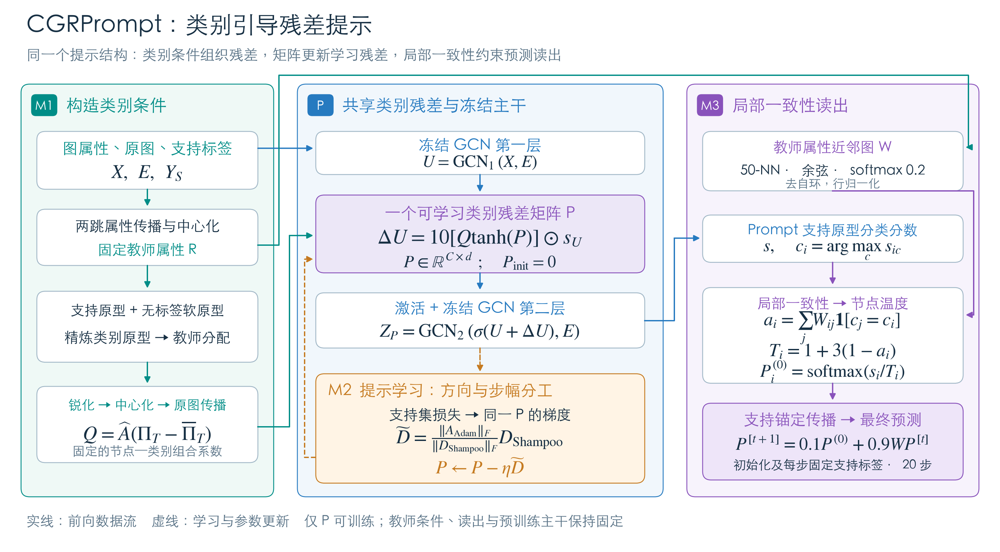
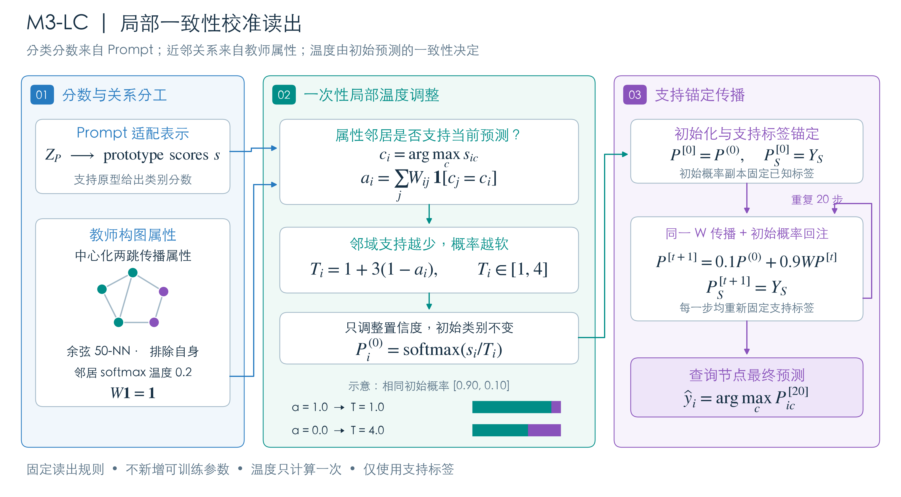

> 本版已按用户指定的原版风格重新绘制。请使用[最新图件](../Framework_M3LC_原版风格_20260927/图注与文件说明.md)。

# CGRPrompt 与 M3-LC Framework（2026-09-27 定稿）

本版依据新M3的固定实现重绘。M1、M2保持原方案，整体采用“CGRPrompt：类别引导残差提示”。新M3包含教师属性构图、局部一致性温度调整以及支持锚定传播。

## 文件入口

| 图 | 中文 PNG | English PNG | 中文矢量 | English vector | 中文可编辑 | English editable |
|---|---|---|---|---|---|---|
| M3 详图 | [查看](M3_LC_CN.png) | [View](M3_LC_EN.png) | [SVG](M3_LC_CN.svg) | [SVG](M3_LC_EN.svg) | [Draw.io](M3_LC_CN.drawio) | [Draw.io](M3_LC_EN.drawio) |
| 总 Framework | [查看](CGRPrompt_Framework_CN.png) | [View](CGRPrompt_Framework_EN.png) | [SVG](CGRPrompt_Framework_CN.svg) | [SVG](CGRPrompt_Framework_EN.svg) | [Draw.io](CGRPrompt_Framework_CN.drawio) | [Draw.io](CGRPrompt_Framework_EN.drawio) |

PNG为3040×1680像素；SVG保留矢量形状与文字；Draw.io包含独立框、文字与连接线，公式使用数学渲染。PNG已逐张检查；Draw.io提供结构化编辑源，尚未在原生编辑器中逐页验证。绘图源码：[build_framework.py](build_framework.py)，依赖Python与Matplotlib。字体使用macOS自带STHeiti，其他系统重绘时需替换为可用中文字体。

## 总图图注

CGRPrompt以固定类别条件组合共享残差，并在冻结编码器的第一层预激活处注入节点修正。M1从支持原型与无标签软原型产生类别分配，经锐化、中心化及原图传播得到固定组合系数。M2利用支持集损失更新同一个类别残差矩阵，将Shampoo方向的整体范数匹配至同轨迹Adam候选方向。M3使用Prompt表示产生的分类分数，以教师属性构建近邻图，根据初始预测的邻域一致性调整节点温度，最后执行支持锚定的概率传播。实线表示前向数据流，虚线表示学习与参数更新；仅类别残差矩阵可训练。

**English caption.** CGRPrompt conditions a shared class-residual matrix on fixed node–class assignments and injects the resulting corrections into a frozen graph encoder. M1 constructs the assignment coefficients from refined prototypes. M2 updates the same residual matrix using a Shampoo direction rescaled to the norm of an Adam reference. M3 combines Prompt classification scores with a teacher-attribute neighbor graph, adjusts node temperatures according to initial prediction agreement, and performs support-clamped diffusion. Solid arrows denote forward data flow; dashed arrows denote learning and parameter updates.

## M3图注与符号

Prompt的适配表示给出初始分类分数，中心化两跳传播属性用于构建去自环余弦50近邻图。近邻权重经温度0.2的softmax归一化。加权局部一致性比较近邻节点的Prompt初始预测，不比较教师分类器与Prompt的输出。节点温度只计算一次，低一致性节点使用更高温度。校准后概率作为固定回注源，其副本先固定支持标签，再进行20步传播；每步重新固定支持标签。插图中的五节点关系及两类概率条仅示意机制，不是实际50近邻图或实验结果。

图中以 $ P^{(0)} $ 表示固定的校准概率，以 $ P^{[t]} $ 表示第 $ t $ 步迭代状态，避免将“回注源”和“已锚定的迭代状态”混为一谈：

$$ P^{[0]}=P^{(0)},\qquad P_S^{[0]}=Y_S. $$

$$ P^{[t+1]}=0.1P^{(0)}+0.9WP^{[t]},\qquad P_S^{[t+1]}=Y_S. $$

只有迭代状态执行支持标签覆盖；固定回注源仍保留校准后的原始概率。这与[m3_lc.py](../../CGRPrompt_M3持续优化_20260927/定稿/m3_lc.py)一致。两类概率条从[0.90, 0.10]出发，温度1时保持原值，温度4时约为[0.634, 0.366]，两者argmax相同。

**English caption.** M3-LC separates Prompt classification scores from teacher-attribute graph construction. Weighted agreement among the initial Prompt predictions determines a fixed node temperature. Calibrated probabilities serve as a persistent reinjection source. A separate diffusion state is clamped to the support labels at initialization and after each of 20 updates. The temperature adjustment preserves the pre-diffusion argmax and introduces no trainable parameters. The small graph and probability bars illustrate the mechanism only.

## 与历史版本的关系

2026-09-26总图和独立M3图使用适配表示构图，不能继续作为定稿M3的结构图。本目录为当前图件入口，历史文件保留用于追溯。旧版PPT没有在本次自动替换，制作新版汇报时应引用本目录图件。
