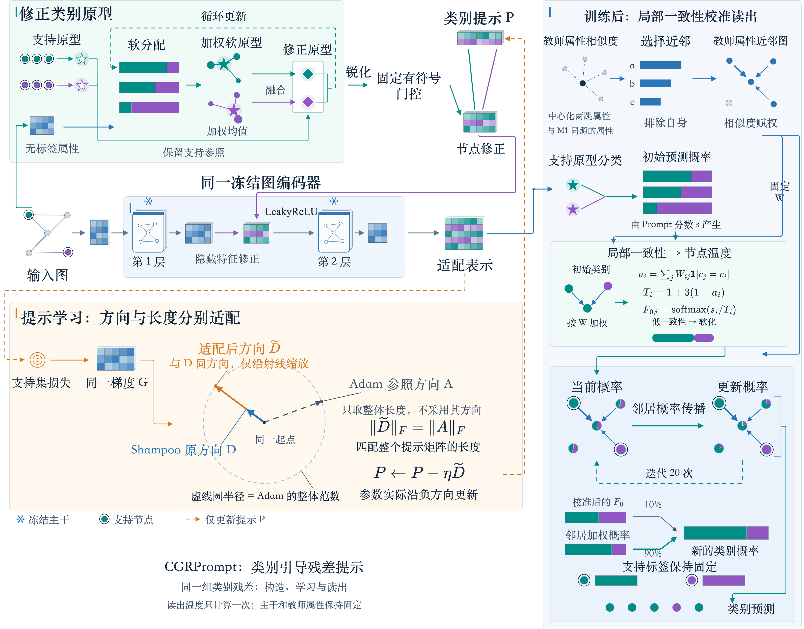

# M3-LC 与总 Framework：原版风格重绘

按指定的两个参考目录重绘：总图直接保留“论文总Framework_鲜明大字双语版_20260926”的原型、矩阵、冻结图编码器和M2方向几何组件；M3详图复用“三个模块Framework详解_20260926”的散点、原型星标、概率条、节点饼图及一次更新放大图。新内容沿用各自的字体、配色和连接线样式。

本版替代此前的三列公式框版本。正式M3为M3-LC，M1/M2仍沿用定稿结构。

| 图件 | PNG | 矢量 PDF | 矢量 SVG | 可编辑源 |
|---|---|---|---|---|
| M3-LC机制详图（中文） | [查看](M3_LC_机制详解.png) | [下载](M3_LC_机制详解.pdf) | [下载](M3_LC_机制详解.svg) | [绘图脚本](build_m3.py) |
| 总Framework（中文） | [查看](Framework_CN.png) | [下载](Framework_CN.pdf) | [下载](Framework_CN.svg) | [Draw.io](Framework_CN.drawio) |
| 总Framework（English） | [View](Framework_EN.png) | [PDF](Framework_EN.pdf) | [SVG](Framework_EN.svg) | [Draw.io](Framework_EN.drawio) |

[中英双页 Draw.io](Framework_中英双页.drawio)。总图使用原生draw.io导出，详图为矢量绘图；三份PDF均另行栅格化验收。历史参考文件未覆盖。

## 总图图注

CGRPrompt以固定类别条件组合共享类别残差，并将节点修正注入同一冻结图编码器。M1生成类别条件，M2更新同一个提示矩阵。训练后，Prompt适配表示给出分类分数，教师的中心化两跳属性提供近邻关系。M3-LC根据近邻上的初始预测一致性计算节点温度，生成校准概率；随后回注该概率并沿固定近邻图传播，在初始化和每步传播后将支持行恢复为已知标签。温度计算一次，传播20步，不新增可学习参数。

**English caption.** CGRPrompt uses fixed class conditions to combine shared class residuals inside a frozen graph encoder. M1 constructs the conditions, while M2 updates the same prompt matrix. At readout, Prompt representations provide classification scores and centered two-hop teacher features define the neighbor graph. M3-LC computes node temperatures from initial prediction agreement, then diffuses the calibrated probabilities with reinjection and support-label clamping. Temperatures are computed once, and diffusion runs for 20 steps without additional trainable parameters.

## M3详图图注

上排以Prompt表示和支持原型产生初始分类概率与类别。第二排以独立的教师属性建立去自环余弦近邻图，经温度0.2的softmax生成行归一化权重。绿色区域展开“邻居是否同类—加权一致性—节点温度—校准概率—支持锚定初始化”。底部沿用原版的一次传播放大图：90%邻居加权概率加10%固定校准概率，覆盖支持标签后重复20轮。

实际使用50个近邻；五节点、两类别、3近邻数值示例只解释计算。新图全部示例概率已按LC重新计算，详见[M3_数值算例.json](M3_数值算例.json)。目标节点v的一致性约0.665，温度约2.004，初始[0.55,0.45]校准为约[0.525,0.475]；第一轮支持锚定传播后的v概率约[0.755,0.245]。校准不改变初始argmax。

图中 $ F_0 $ 是保留不变的校准概率，$ F^{(t)} $ 是迭代状态。初始化复制 $ F_0 $ 后覆盖支持行；每步更新仍回注未覆盖的 $ F_0 $，随后再次覆盖支持行。该约定与定稿代码一致。

## 源码与核验

- [总图绘图脚本](build_total.py)：直接读取指定原版Draw.io，保留M1/M2及主干组件，替换旧构图入口、增加LC组件并延长读出区。
- [组件保留检查](原版组件保留检查.json)：逐对象比较原版与新版，验证M1/M2和主干对象原样保留，外部分类路由单独更新。
- [M3绘图脚本](build_m3.py)：复用指定原版详图的图形原语，并对数值算例重算。
- [当前叙事](../CGRPrompt_边预测预训练叙事_20260927.md)；[M3固定实现](../../CGRPrompt_M3持续优化_20260927/定稿/m3_lc.py)。
